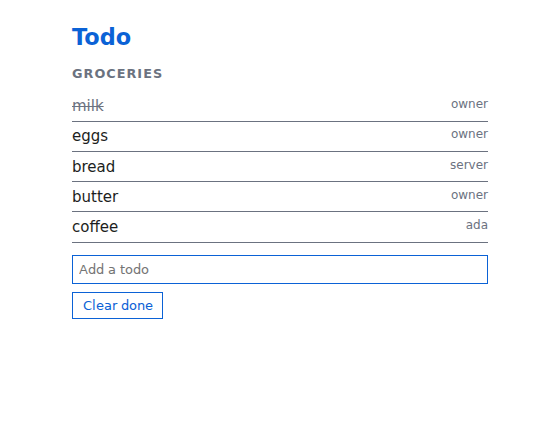
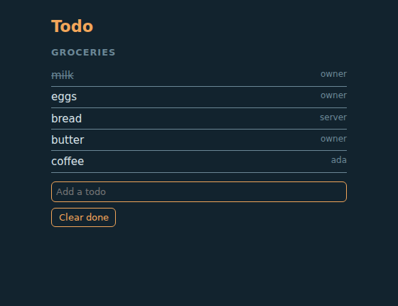
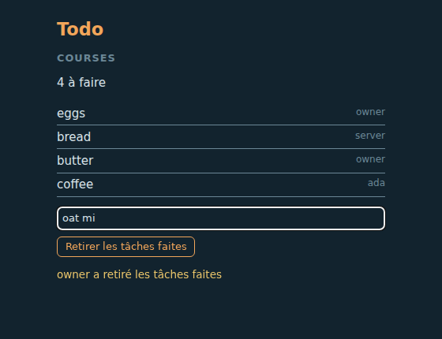
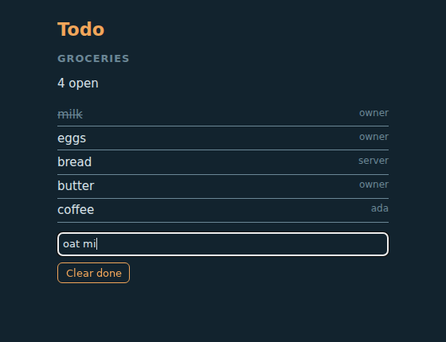
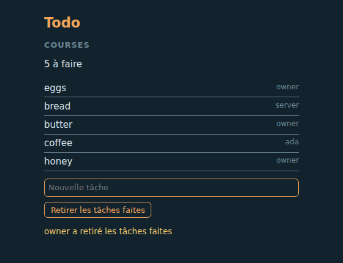
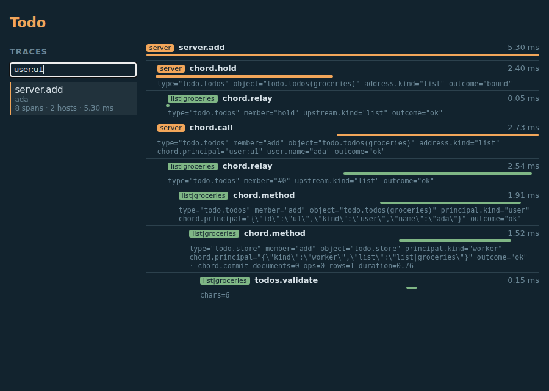

# The PiG Chord tutorial

A shared todo app built with Chord's app kit in Go, one chapter at a time. It is the Go form of Pi's tutorial (`packages/chord/docs/tutorial/book.md`), chapter by chapter: the server and the owner's sign-in, a list on its own worker, routes, a page, a terminal, a theme added while the app runs, a second user, languages, an edit applied in place, a list moved to another address, telemetry with a trace viewer, and the test of one plugin. The plugins are TypeScript, as in Pi, and run in the Node host; the app that starts the server and its workers is Go, and so is the code of the server's own process (routes, the trace viewer's half on the server, the steps).

The app is `examples/chord-todo`. Run every step at once from the repository root:

```sh
go run ./examples/chord-todo
```

With Node 26.5.1 or later (`CHORD_TUI_NODE`, else `node`) the terminal client of chapter V runs too, because its sandbox needs that Node; with an older one that step says so and the rest runs. The screenshots of the chapters are taken by `TestTheTutorialTakesTheScreenshots` in headless Chromium (`CHROMIUM_BIN`).

Every code block below is quoted from the example, and every console output from what its steps print. `examples/chord-todo/tutorial_test.go` does Pi's three checks and fails when one drifts: every Go, TypeScript, JSON and CSS block is quoted from a file (`<!-- quote: path -->` above it), each quoted block is still in its file, and each console output the book shows (`<!-- output: main -->`, `<!-- output: tui -->` when a Node for the sandbox is there, `<!-- output: screenshots -->` with Chromium) is among the lines the steps print, in order. The screens are checked too: each is a PNG of the size it was taken at.

## Ten things to know

1. **An app is its API, its plugins and a start program.** `app.StartServer` makes the data directory, the store, the server host, HTTP with sign-in, the workers and the plugin roots; `app.StartWorker` does a worker's half.
2. **A host is one participant.** The server, each list's worker, each browser tab and each terminal are hosts, connected by links. Tabs and terminals are clients: they connect and ask, nobody asks them.
3. **An object is reached by its contract.** A contract names an object type, its params and its members; a `remote` contract also says which host serves it. Any host asks for `Todos { list: "groceries" }`, and Chord routes the request to that list's worker.
4. **Who calls is stamped, never sent.** Every call carries a principal the link stamped from the sign-in. A factory picks a variant per principal; a todo records who added it from the principal, not from its arguments.
5. **A plugin has one file per host kind.** `worker.ts`, `web.ts`, `tui.ts`: each declares what that kind of host serves and contributes. Plugins import only the app's API. The server's own code is Go.
6. **Plugins meet in registries.** The page shows `Panels`, the terminal `Screens`, the kit's `Themes` restyle both; plugins contribute, one plugin (or the entry) composes.
7. **Changes apply when you say so.** Saving a file marks its plugin dirty; `ApplyChanges` builds and rolls out to the server, the workers, the pages and the terminals, in place.
8. **Text is rendered per viewer.** A plugin's messages are typed code, a translation is a plugin, each user picks a language, and servers store keys, never sentences.
9. **One click is one trace.** The server writes the telemetry store (here one SQLite file in the data directory); the page and the workers send it their spans; carriers in the calls' headers join them into one trace.
10. **Six traps:** load before use; a reference acts as whoever made it; await what you start; a watch starts at the current value; the plain `t` has no language of its own; a trace starts where a span starts.

## Where PiG differs from Pi in this tutorial

Nothing in the model differs; these points of the app differ, and each is said where it comes up.

- The app's start program, its principals, the contract `Todos` for the Go code and the steps are Go. A principal is a JSON value; a contract is data, so the Go declaration of `Todos` and the plugin's `contract.ts` bind.
- The server's own code is Go, so the routes of chapter III and the trace viewer's routes of chapter XI are Go facets the app loads (`AppOptions.Facets`), where Pi's app has server plugins: a plugin directory is TypeScript the Node host evaluates, and it cannot contribute Go handlers to the HTTP registry. The kit's pick-a-name login is loaded the same way (chapter VII).
- A worker is the program's own executable run again with `TODO_ROLE_WORKER` set; there is no separate worker entry file.
- The page's and the terminal's base bundles are built by the kit from files by path: the example's `client/` directory names the vendored Chord of the client tree by relative path where Pi's imports a workspace package (chapter IV).
- A worker's host records spans with Chord's default principal attribute: its spans say `chord.principal` as the principal's canonical JSON, where the server's, with the app's `PrincipalAttributes` hook, say `owner` or `user:u1` (chapter XI).

# One Server

An app built with the kit has a fixed shape: its API (`api/v<n>`), its built-in plugins in a root directory, and a start program. Everything else is a plugin. This chapter writes the base code and starts the server.

## The principals

A **principal** says who is calling. The app defines it; the kit needs a principal for the server, one for each of its workers (an app without worker kinds leaves it out) and one for the owner, whom the owner's sign-in names. A principal is a JSON value, so the Go app writes it as one:

<!-- quote: main.go -->
```go
// The app's principals: its server, its owner, one for each list's worker, and a user who signed in with a name (chapter VII).
var (
	serverPrincipal data.Principal = delta.JsonObjectOf("kind", "server")
	ownerPrincipal  data.Principal = delta.JsonObjectOf("kind", "owner")
)
```

A principal travels with every call and is part of objects' identities, so it stays small: a kind and an id. A worker's principal names its list (chapter II); a user's, which the kit's login makes (chapter VII), names her. A user's profile, if the app had one, would be data in an object keyed by the id.

<!-- quote: main.go -->
```go
// workerPrincipal is the principal of the worker of the list at address.
func workerPrincipal(address contracts.Address) data.Principal {
	return delta.JsonObjectOf("kind", "worker", "list", address.Key)
}
```

## The API

Plugins never import Chord. They import the app's **API**, a module the app names with a version in its path (`@todo/app/v1`). It re-exports the part of Chord the app supports and adds what is the app's own: `defineFacet` typed with the app's principals, and the app's host kind (chapter II):

<!-- quote: api/v1.ts -->
```ts
// The todo app's API, version 1: the module its plugins import as `@todo/app/v1`. It re-exports the part of Chord the app
// supports; a plugin never imports Chord itself.
export * from "@earendil-works/chord";
export { BACKGROUND_CONTEXT } from "@earendil-works/chord/context";

import { defineFacet as chordFacet, type FacetHost, type FacetSelf, hostKind, str } from "@earendil-works/chord";
import type { TodoPrincipal } from "./principals.ts";

export type { TodoPrincipal } from "./principals.ts";
```

The API is a **host package**: a plugin's build leaves it out, and each process hands the plugin its own instance when it evaluates it. A version in the path lets the app ship `v2` beside `v1` later; one facet uses one version. The Go app names the module and the file that holds it (Pi's workspace package and its `package.json` exports have no Go counterpart: the program names each module's file):

<!-- quote: main.go -->
```go
// api is the app's API: its name, its versions (newest first), and this process's modules of them.
func api() app.AppAPI {
	return app.AppAPI{
		Name:     "@todo/app",
		Versions: []string{"v1"},
		Modules:  plugins.HostPackages{"@todo/app/v1": filepath.Join(here, "api", "v1.ts")},
	}
}
```

## The start program

`StartServer` takes what the app decides and does the rest. The program names the facet kinds (which files a plugin may have), and starts the server with its API, kinds and principals:

<!-- quote: main.go -->
```go
// kinds are the app's facet kinds: a plugin has one file per kind it runs on (`server.ts`, `worker.ts`).
func kinds() []app.AppKindEntry {
	return []app.AppKindEntry{
		{Name: "server", Kind: app.AppKind{Platform: model.PlatformNode}},
		{Name: "worker", Kind: app.AppKind{Platform: model.PlatformNode}},
		{Name: "tui", Kind: app.AppKind{Platform: model.PlatformNode, Packages: plugins.HostPackages{"@todo/app/v1/tui": filepath.Join(here, "client", "tui.ts")}}},
		{Name: "web", Kind: app.AppKind{Platform: model.PlatformBrowser, Packages: plugins.HostPackages{
			"react": "", "react/jsx-runtime": "",
			"@todo/app/v1/web": filepath.Join(here, "client", "web.ts"),
		}}},
	}
}
```

The web kind keeps React and the page's API as host packages (the page provides them), the terminal kind the terminal's. A worker loads the worker facets only, so its own list of kinds is the first two. The start itself:

<!-- quote: main.go -->
```go
func startTodo(ctx context.Context, dataDir, root string, store *telemetrysqlite.SqliteTelemetry) (*app.App, error) {
	executable, err := os.Executable()
	if err != nil {
		return nil, err
	}
	return app.StartServer(app.AppOptions{
		Name:    "todo",
		DataDir: dataDir,
		Root:    root,
		Listen:  &chordhttp.ListenAddress{Host: "127.0.0.1", Port: 0},
		API:     api(),
		Kinds:   kinds(),
		Principal: app.AppPrincipals{
			Server: serverPrincipal,
			Worker: workerPrincipal,
			Owner:  ownerPrincipal,
		},
		Workers: []app.AppWorkerKind{{
			Kind:  listKind,
			Entry: executable,
			Env:   map[string]string{workerEnv: "1"},
			Start: func(contracts.Address, context.Context) (delta.JsonValue, error) { return delta.NewJsonObject(0), nil },
			// Who may reach a list's worker: everyone signed in, and the server itself.
			Authorize: func(principal data.Principal, _ contracts.Address) bool {
				return principal.Value("kind") != "worker"
			},
		}},
		// The kit's pick-a-name login (a Go app loads it itself, where Pi's app has a one-line plugin) and the lists' routes.
		// The store the server writes: its own spans and metrics, and what the workers and recording pages send.
		Telemetry: store,
		// Who a span was for: a short key and a user's name.
		PrincipalAttributes: principalAttributes,
		Facets: []host.HostFacet{
			{Name: "chord.app.ephemeral", Facet: app.EphemeralLoginFacet()},
			{Name: "@todo/routes", Facet: routes()},
			{Name: "@todo/traces", Facet: tracesFacet(dataDir)},
		},
		// The page: the app's own HTML around the assets the kit made.
		Web:     &app.AppWeb{Entry: filepath.Join(here, "client", "page.ts"), Page: page, Paths: []string{"/", "/traces"}, Conditions: []string{"source"}},
		Tui:     &app.AppTui{Entry: filepath.Join(here, "client", "terminal.ts"), Conditions: []string{"source"}},
		OnError: func(err app.AppError) { fmt.Fprintln(os.Stderr, "todo:", err.Kind, err.Error) },
	}, ctx)
}
```

`workers` is chapter II, `Facets` (the routes, the login, the trace viewer's routes) chapters III, VII and XI, `Web` chapter IV (its second path, `/traces`, chapter XI), `Tui` chapter V, `Telemetry` and `PrincipalAttributes` chapter XI. `Listen` asks for a free port on loopback, as the example does; a real app picks a port. A worker is a program that calls the kit's `StartWorker`, here the same executable:

<!-- quote: main.go -->
```go
// workerEnv is set in a worker's environment: the program is the worker of a list then, not the app.
const workerEnv = "TODO_ROLE_WORKER"

// startWorker runs this process as a list's worker: it opens the list's store in its directory, connects to the server and loads
// the plugins' worker facets. It does not return.
func startWorker() {
	app.StartWorker(app.WorkerOptions{
		API: api(),
		// A worker runs the plugins' worker facets only: the page's and the terminal's packages are not its.
		Kinds:       kinds()[:2],
		WorkerKinds: []*contracts.HostKind{listKind},
		OnError:     func(err any) { fmt.Fprintln(os.Stderr, "list:", err) },
	})
}
```

`main` runs the worker when the environment says so (and the example's test binary does too, in its `TestMain`).

## Running it

Step 1 of `run` opens the telemetry store (chapter XI), starts the app, tries the page without signing in, then does what a browser does with the owner link:

<!-- quote: main.go -->
```go
	store, err := openTelemetry(telemetryFile(dataDir))
	if err != nil {
		return err
	}
	defer func() { _ = store.Close() }()
	server, err := startTodo(ctx, dataDir, root, store)
	if err != nil {
		return err
	}
	defer closeServer(ctx, server)
	link, err := url.Parse(server.OwnerLink())
	if err != nil {
		return err
	}
	origin := link.Scheme + "://" + link.Host
	_, _ = fmt.Fprintln(out, "1. owner link:", "http://127.0.0.1:<port>"+link.Path+"#<token>")
	entries, err := os.ReadDir(dataDir)
	if err != nil {
		return err
	}
	var names []string
	for _, entry := range entries {
		names = append(names, entry.Name())
	}
	slices.Sort(names)
	_, _ = fmt.Fprintln(out, "   data directory:", strings.Join(names, ", "))
	signedOut, err := http.Get(origin) //nolint:gosec // G107: origin is the loopback address the server just listened on
	if err != nil {
		return err
	}
	_ = signedOut.Body.Close()
	_, _ = fmt.Fprintln(out, "   GET / signed out:", signedOut.StatusCode)
	signIn, err := http.Post(origin+app.OwnerPath, "application/json", strings.NewReader(`{"token":"`+link.Fragment+`"}`))
	if err != nil {
		return err
	}
	_ = signIn.Body.Close()
	cookies := signIn.Cookies()
	if len(cookies) == 0 {
		return fmt.Errorf("the owner's sign-in set no cookie (status %d)", signIn.StatusCode)
	}
	cookie := cookies[0]
	_, _ = fmt.Fprintln(out, "   the owner signs in:", signIn.StatusCode, cookie.Name+"=…")
	request, err := http.NewRequest(http.MethodGet, origin, nil)
	if err != nil {
		return err
	}
	request.AddCookie(cookie)
	signedIn, err := http.DefaultClient.Do(request)
	if err != nil {
		return err
	}
	_ = signedIn.Body.Close()
	_, _ = fmt.Fprintln(out, "   GET / signed in:", signedIn.StatusCode)
```

<!-- output: main -->
```text
1. owner link: http://127.0.0.1:<port>/_chord/owner#<token>
   data directory: cache, logs, owner-token, plugins, server, telemetry.sqlite, telemetry.sqlite-shm, telemetry.sqlite-wal, workers
   GET / signed out: 401
   the owner signs in: 200 chord-session=…
   GET / signed in: 200
```

`closeServer` is what the step defers: closing the app does not wait for the builds and the scan it started, so it then waits (bounded) for them to end, and none outlives the run:

<!-- quote: main.go -->
```go
func closeServer(ctx context.Context, server *app.App) {
	_ = server.Close(ctx)
	waited, cancel := context.WithTimeout(context.WithoutCancel(ctx), time.Minute)
	defer cancel()
	_ = server.Wait(waited)
}
```

`StartServer` made the data directory: `server/` (its store, the cookie secret, its files), `workers/` (one directory per worker), `plugins/` (the user's plugin root, beside the app's built-in one), `cache/` (the workers' bases), `logs/`, `owner-token` and the telemetry store's files. Without the owner's session both requests are answered 401: the kit answers it before a route or the page runs; once signed in, the page is served.

The **owner link** (`/_chord/owner#<token>`) is how the owner gets in: a single-use token, valid ten minutes, made at each start. It sits in the URL's fragment, which browsers never send, so it never reaches a log; the link's page posts it and receives a session cookie. A command-line client on the same machine reads `owner-token` instead (mode 0600). Nothing is the owner because it comes from loopback: any local process could.

# A List on Its Own Worker

Each list gets its own process, a **worker**, with its own store: a list that misbehaves cannot take the others down, and an idle list costs nothing. This chapter declares where lists live, what a list offers, and the worker code that keeps its todos.

## Where a list lives

A **host kind** declares addressable hosts with params; `List({ id: "groceries" })` is an **address**. The app's host kinds are base code: in the API for the plugins, and as a value in the Go program:

<!-- quote: api/v1.ts -->
```ts
/** A todo list: a worker process of its own, with its own store. */
export const List = hostKind("list", { id: str() });
```

<!-- quote: todos.go -->
```go
// listKind is the app's host kind: a todo list, a worker process of its own with its own store (`List` of api/v1.ts).
var listKind = func() *contracts.HostKind {
	kind, err := contracts.NewHostKind("list", contracts.Prop("id", contracts.Str()))
	if err != nil {
		panic(err)
	}
	return kind
}()
```

A `remote` contract says, with `hostAddress`, at which address its objects live. The contract for a list's todos is the lists plugin's, in its `contract.ts`, which its facets of every kind import:

<!-- quote: plugins/lists/contract.ts -->
```ts
export const Todos = remote("todo.todos", {
	version: 1,
	params: { list: str() },
	hostAddress: ({ list }) => List({ id: list }),
	variants: {
		member: {
			state: { items: arr(Item), notice: Notice },
			methods: { add: method(str()), tick: method(obj({ id: int(), done: bool() })) },
		},
		owner: {
			state: { items: arr(Item), notice: Notice },
			methods: { add: method(str()), tick: method(obj({ id: int(), done: bool() })), clear: method() },
		},
	},
});
```

Its `notice` is a message as data, which chapter VIII renders in each viewer's language. `params` select the instance: `Todos { list: "groceries" }` is one object per principal. Nobody who asks names a host: the caller computes the address from the params and sends the request there; a host that cannot serve it passes it on to its parent or to a route. The kit's `Workers` option is that route. The Go steps ask for `Todos` too, so the program declares the same contract with Go's builders (a contract is data: the same name, version and schema bind):

<!-- quote: todos.go -->
```go
// todos is `Todos` of the lists plugin's contract.ts, declared again with Go's builders: a contract is data, so the same name,
// version and schema bind. Its objects live at a list's address, on that list's worker.
var todos = func() *contracts.Contract {
	notice := contracts.Union([]contracts.Schema{surfaces.MessageSchema, contracts.Nul()})
	state := []contracts.Property{contracts.Prop("items", contracts.Arr(item)), contracts.Prop("notice", notice)}
	add := contracts.Meth("add", contracts.NewMethod(contracts.Str()))
	tick := contracts.Meth("tick", contracts.NewMethod(contracts.Obj(contracts.Prop("id", contracts.Int()), contracts.Prop("done", contracts.Bool()))))
	contract, err := contracts.Remote("todo.todos", contracts.RemoteDeclaration{
		Version: 1,
		Params:  contracts.Params{contracts.Prop("list", contracts.Str())},
		HostAddress: func(params *delta.JsonObject) (contracts.Address, error) {
			return listKind.Address(delta.JsonObjectOf("id", params.Value("list"))), nil
		},
		Variants: []contracts.VariantEntry{
			contracts.Var("member", contracts.VariantDeclaration{State: state, Methods: []contracts.MethodEntry{add, tick}}),
			contracts.Var("owner", contracts.VariantDeclaration{State: state, Methods: []contracts.MethodEntry{add, tick, contracts.Meth("clear", contracts.NewMethod())}}),
		},
	})
	if err != nil {
		panic(err)
	}
	return contract
}()
```

and `StartServer` is told where the workers are:

<!-- quote: main.go -->
```go
		Workers: []app.AppWorkerKind{{
			Kind:  listKind,
			Entry: executable,
			Env:   map[string]string{workerEnv: "1"},
			Start: func(contracts.Address, context.Context) (delta.JsonValue, error) { return delta.NewJsonObject(0), nil },
			// Who may reach a list's worker: everyone signed in, and the server itself.
			Authorize: func(principal data.Principal, _ contracts.Address) bool {
				return principal.Value("kind") != "worker"
			},
		}},
```

`Authorize` runs for every request routed to a list before anything starts; the first request for an address starts its worker (the program itself, with `workerEnv` set), and a worker idle for five minutes (the default `IdleMs`) stops. **Variants** are the member sets a contract offers: the owner's `Todos` has `clear`, a member's does not. The factory picks one per principal.

## The worker facet

The lists plugin is a directory with a `package.json` (its name is the plugin's name) and one file per host kind it runs on. `worker.ts` is its **worker facet**: what every list's worker serves. It keeps the todos in a **table** of the worker's store:

<!-- quote: plugins/lists/worker.ts -->
```ts
/** Every todo of the list, by its number. */
const Items = defineTable("todo.items", {
	version: 1,
	columns: { id: int(), text: str(), done: bool(), by: str(), at: num() },
	key: ["id"],
});

/** The newest todos first. */
const NEWEST = query(Items).orderBy((item) => item.id, "desc");

/** How many todos the live query holds. */
const WINDOW = 50;
```

A table holds many records with queries and pages; it lives in an object, never in a facet. Persisted data lives only in `local` objects with empty params (one per host and type), so its address never depends on who asked. That object is the plugin's store, `Store`, a local contract of its own file:

<!-- quote: plugins/lists/worker.ts -->
```ts
/** The list's todos, once per worker: empty params, so it lives as long as the worker and may keep data in its store. */
const Store = local("todo.store", {
	version: 1,
	params: {},
	members: {
		items: arr(Item),
		notice: Notice,
		add: method(obj({ text: str(), by: str() })),
		tick: method(obj({ id: int(), done: bool() })),
		clear: method(obj({ by: str() })),
	},
});
```

A `local` object with empty params lives as long as its host: it starts with the worker and is never ended by a count of references. Its factory declares its parts and returns its members:

<!-- quote: plugins/lists/worker.ts -->
```ts
	host.serve(Store, (_params, self) => {
		const items = self.table(Items);
		// The newest todos, live: read before the store goes live, read again after every commit writing the table.
		const newest = self.query(items, NEWEST, WINDOW);
		const notices = self.state(Notices);
		return {
			// Oldest first, as the list shows them.
			items: self.derive([newest], ([rows]) => [...rows].reverse()),
			notice: self.derive([notices], ([value]) => value.notice),
```

A **factory** is synchronous and only declares; Chord activates the object afterwards. `self.table` declares the table. `self.query(items, NEWEST, WINDOW)` declares a **live query** over it: the rows of `NEWEST`, at most 50, as a value the object can expose or derive from. Chord runs it before the store goes live, and again after every commit of the store that writes `items`, and sends watchers only what changed. The store's derive turns the rows around, oldest first, for the list.

A live query reads only its own object's tables: only the store writes them, so its own commits are exactly the moments the rows can change, and a commit that writes no table with a query costs nothing. The limit is required: each such commit runs the query once more, at most `WINDOW` rows. That is cheap for a list a person edits and wrong for a table written hundreds of times a second.

Writes go through **transactions**: `self.tx(fn, ctx)` runs `fn` with `tx`, and what it stages is committed at once when `fn` returns, or not at all if it throws. The live query follows in the same commit; the store keeps nothing else in memory, not even the next todo's number, which it reads in the transaction:

<!-- quote: plugins/lists/worker.ts -->
```ts
			add: async ({ text, by }, ctx) => {
				// A span of its own under the method's: a trace shows the check, and why it refused.
				await ctx.trace("todos.validate", { chars: text.length }, async () => {
					// Refused as Chord refuses arguments that fail their schema: the caller gets `invalid/args`.
					if (text === "") throw invalid("args", "a todo needs text");
				});
				await self.tx(async (tx) => {
					// The number after the newest todo's: the store's transactions run one after another.
					const { items: last } = await tx.page(items, NEWEST, 1);
					tx.put(items, { id: (last[0]?.id ?? 0) + 1, text, done: false, by, at: Date.now() });
				}, ctx);
				return null;
```

A todo without text is refused with `invalid("args", …)`, from the API: the error crosses every link as it is, so a caller on a page or in a terminal gets `invalid/args`, as for arguments that fail the contract's schema. The check runs in a span of its own (`ctx.trace`), which chapter XI shows in a trace.

## The view per principal

`Todos` is the remote face of the store, one object per principal. Its factory gets the principal the link stamped:

<!-- quote: plugins/lists/worker.ts -->
```ts
	host.serve(Todos, (_params, principal, self) => {
		const store = self.get(Store, {});
		// Who adds a todo comes from the principal the link stamped, never from the arguments.
		const by = principal.kind === "user" ? principal.name : principal.kind;
		const members = {
			items: self.derive([store.items], ([items]) => items),
			notice: self.derive([store.notice], ([notice]) => notice),
			add: (text: string, ctx: Ctx) => store.add({ text, by }, ctx),
			tick: (tick: { id: number; done: boolean }, ctx: Ctx) => store.tick(tick, ctx),
		};
		if (principal.kind !== "owner") return { variant: "member", members };
		return { variant: "owner", members: { ...members, clear: (ctx: Ctx) => store.clear({ by }, ctx) } };
	});
```

`self.get(Store, {})` declares a dependency: the view goes live once the store is, and holds a **reference** to it for its whole life. `by` comes from the principal. A client could put anything in the arguments of `add`; it cannot change what its link stamped. That is the rule for every plugin: identity from the principal, never from arguments.

## Running it

Step 2 asks for the groceries list twice, from a root acting as the owner and from a root of the server itself. The steps after the first are methods of a `session`, which holds the running app and the helpers (`asRoot` runs code in a root of the server's host acting as a principal):

<!-- quote: lists.go -->
```go
	groceries := delta.JsonObjectOf("list", "groceries")
	err := s.asRoot(ownerPrincipal, func(ctx host.Ctx) error {
		todos, err := ctx.Get(todos, groceries, host.GetOptions{})
		if err != nil {
			return err
		}
		for _, text := range []string{"milk", "eggs"} {
			if _, err := todos.Call("add", text, ctx); err != nil {
				return err
			}
		}
		if _, err := todos.Call("tick", delta.JsonObjectOf("id", 1, "done", true), ctx); err != nil {
			return err
		}
		items, err := itemsUntil(todos, func(items []todo) bool { return len(items) == 2 && items[0].Done })
		if err != nil {
			return err
		}
		variant, _, err := todos.Variant()
		_, _ = fmt.Fprintln(s.out, "2. as the owner:", variant, "|", show(items))
		return err
	})
	if err != nil {
		return err
	}
	err = s.asRoot(serverPrincipal, func(ctx host.Ctx) error {
		todos, err := ctx.Get(todos, groceries, host.GetOptions{})
		if err != nil {
			return err
		}
		if _, err := todos.Call("add", "bread", ctx); err != nil {
			return err
		}
		items, err := itemsUntil(todos, func(items []todo) bool { return len(items) == 3 })
		if err != nil {
			return err
		}
		variant, _, err := todos.Variant()
		_, _ = fmt.Fprintln(s.out, "   as the server:", variant, "|", show(items[2:]))
```

<!-- output: main -->
```text
2. as the owner: owner | [x] milk (owner), [ ] eggs (owner)
   as the server: member | [ ] bread (server)
   workers: list|groceries
   workers/list/list%7Cgroceries: .host-data.mjs, kit.sqlite, kit.sqlite-shm, kit.sqlite-wal, store.sqlite, store.sqlite-shm, store.sqlite-wal
```

A **root** (`Host.Root(fn, ctx, RootOptions{Principal})`) is a call scope for code outside objects; its `ctx` carries the principal and cancellation, and the references `ctx.Get` takes end when `fn` returns. The first request started the list's worker, `list|groceries`, with its own store in `workers/list/list%7Cgroceries/` (the kit's own `kit.sqlite` beside it).

## Trap: who a reference acts as

The two roots made the same call and got different todos: `milk (owner)` and `bread (server)`. **A reference acts as whoever made it.** `ctx.Get` in a root or a method acts as that context's principal; `Host.Get`, and `self.get` in a `local` object, act as the host; `self.get` in a remote object acts as that object's principal. So a route whose request came from the owner reaches the worker as the owner (chapter III), and a guest's call cannot borrow the server's authority. The surprise is the reverse case: a server method that wants to act as the server towards a worker must not use its caller's `ctx.Get`; it takes the reference with the host, or in a root of the server's own.

## Trap: await what you start

Every write above is awaited, and that is not style. What is started with a context ends with it: a root's scope seals when `fn` returns, and a method's context ends with its call. A call started inside a root that returns at once is cancelled before it commits; Chord rejects it and reports `transaction_cancelled` through `OnError`, so a write that never happened is not hidden. Fire and forget only with a context that does not end, as the page does with `BACKGROUND_CONTEXT` in chapter IV.

# Routes

The page will talk Chord over a WebSocket. A script on Mara's machine is happier with HTTP. A server facet contributes routes to the kit's `Http` registry. A Go app's server facet is a Go facet the app loads through `Facets`:

<!-- quote: routes.go -->
```go
func routes() host.Facet {
	return host.DefineFacet(func(_ host.FacetHost, self host.FacetSelf) error {
		return self.Contribute(registries.Registry[any, any](chordhttp.Http), chordhttp.HttpContribution{Routes: []chordhttp.HttpRouteEntry{
			chordhttp.RouteFunc("GET /api/lists/:list", func(request chordhttp.HttpRequest, ctx host.Ctx) (chordhttp.HttpResponse, error) {
				list, err := ctx.Get(todos, delta.JsonObjectOf("list", request.Params()["list"]), host.GetOptions{})
				if err != nil {
					return chordhttp.HttpResponse{}, err
				}
				items, err := list.Member("items").Value()
				return chordhttp.HttpResponse{Kind: chordhttp.KindJSON, Value: items}, err
			}),
			chordhttp.RouteFunc("POST /api/lists/:list", func(request chordhttp.HttpRequest, ctx host.Ctx) (chordhttp.HttpResponse, error) {
				list, err := ctx.Get(todos, delta.JsonObjectOf("list", request.Params()["list"]), host.GetOptions{})
				if err != nil {
					return chordhttp.HttpResponse{}, err
				}
				text, err := request.JSON()
				if err != nil {
					return chordhttp.HttpResponse{}, err
				}
				if _, err := list.Call("add", fmt.Sprint(text), ctx); err != nil {
					return chordhttp.HttpResponse{}, err
				}
				return chordhttp.HttpResponse{Kind: chordhttp.KindJSON, Value: "added"}, nil
			}),
		}})
	})
}
```

A **registry** is an extension point: one owner declares how contributions combine (here the kit's HTTP component builds a router), facets contribute one value each. `self.Contribute` adds the routes while the facet is loaded. A route runs in a root with the request's principal, so `ctx.Get(todos, …)` reaches the list's worker as whoever signed in, and gets their variant. (Pi's `plugins/lists/server.ts` is the same code in a plugin; a plugin cannot hand a Go registry a handler, which is why this half is Go.)

Step 3 is a command-line client with the owner token file:

<!-- quote: routes.go -->
```go
	text, err := os.ReadFile(s.app.OwnerTokenFile)
	if err != nil {
		return err
	}
	s.token = strings.TrimSpace(string(text))
	cli := s.cli()
	_, posted, err := s.request(http.MethodPost, "/api/lists/groceries", []byte(`"butter"`), map[string]string{"Authorization": cli["Authorization"], "Content-Type": "application/json"})
	if err != nil {
		return err
	}
	var answer string
	if err := json.Unmarshal(posted, &answer); err != nil {
		return err
	}
	_, _ = fmt.Fprintln(s.out, "3. POST /api/lists/groceries:", answer)
	_, listed, err := s.request(http.MethodGet, "/api/lists/groceries", nil, cli)
	if err != nil {
		return err
	}
	items, err := itemsOf(json.RawMessage(listed))
	if err != nil {
		return err
	}
	_, _ = fmt.Fprintln(s.out, "   GET /api/lists/groceries:", show(items))
	status, _, err := s.request(http.MethodGet, "/api/lists/groceries", nil, nil)
	_, _ = fmt.Fprintln(s.out, "   GET without a token:", status)
```

<!-- output: main -->
```text
3. POST /api/lists/groceries: added
   GET /api/lists/groceries: [x] milk (owner), [ ] eggs (owner), [ ] bread (server), [ ] butter (owner)
   GET without a token: 401
```

`butter` is the owner's: the route acted as the request's principal. Without a token the kit answered 401 before the route ran. Another machine has no token file; it **pairs** instead: it asks `POST /_chord/pair` for a code, the owner approves the code in a signed-in browser, and the client's next poll returns its token.

# A Page

A page is a client host in the browser. The kit builds its **base bundle** from the app's web entry at start (Chord, React, the app's web modules), serves the plugins' web facets as small scripts beside it, and serves the page through the app's template.

## The page's registry

Plugins put panels on the page through a registry the API's web module declares, with Chord's React hooks re-exported for them. The page's and the terminal's modules are files of the example's `client/` directory. A base bundle is built from files by path, so they name the Chord of the client tree (vendored, with React) by relative path where the plugins' host resolves `@earendil-works/chord` itself; an app with an `npm install` of its own imports `@earendil-works/chord` and `react` by name.

<!-- quote: client/web.ts -->
```ts
/** A panel of the page: its name (a key, never shown) and its React component, which shows its own title. */
export type Panel = { readonly name: string; readonly Component: ComponentType };

/** The page's panels, one per contributing plugin, in plugin-name order. */
export const Panels = defineRegistry<Panel, readonly Panel[]>("todo.panels", { version: 1 });
```

A panel shows its own title, in the page's language; its `name` is only a key. The web entry serves `Panels` (its `compose` keeps the contributions in plugin-name order), renders every panel, and starts the page's connection:

<!-- quote: client/page.ts -->
```ts
/** The page's own facet: it serves `Panels`, composing the contributions in plugin-name order. */
const core = defineFacet((host) => host.serve(v1web.Panels, { compose: (table) => table.map(({ value }) => value) }));

function Page() {
	const panels = useRegistry(v1web.Panels) ?? [];
	// The page's one other path (`startTodo` serves the page at `/` and `/traces`).
	if (location.pathname === "/traces") return h("main", { className: "wide" }, h("h1", null, "Todo"), h(TraceViewer));
	return h(
		"main",
		null,
		h("h1", null, "Todo"),
		...panels.map(({ name, Component }) => h("section", { key: name }, h(Component))),
	);
}

void startPage({
```

<!-- quote: client/page.ts -->
```ts
	connect: () => new WebSocket(`${location.origin.replace(/^http/, "ws")}/chord`),
	modules: { "@todo/app/v1": v1, "@todo/app/v1/web": v1web, react: React, "react/jsx-runtime": jsx },
	core: [{ name: "@todo/web", facet: core }],
	// The page records its clicks and the calls under them, and sends them to the server every few seconds.
	telemetry: true,
	render: (host) => createRoot(document.getElementById("root")!).render(h(HostProvider, { host }, h(Page))),
```

The path `/traces` is the owner's trace viewer, and `telemetry` what it shows (chapter XI). `startPage` makes the page's host, connects it to `/chord` (reconnecting after drops), loads the current plugin scripts with the entry's core facets, and keeps them current. `HostProvider` gives the React tree that host.

## The web facet

`plugins/lists/web.ts` contributes a panel. Its component holds the list's `Todos` while it is mounted and re-renders when its items change:

<!-- quote: plugins/lists/web.ts -->
```ts
function TodoList() {
	const { t } = useMessages(messages);
	const host = useHost();
	const list = location.hash.slice(1) || "groceries";
	const todos = useHold(Todos, { list });
	const items = useWatch(todos?.items) ?? [];
	const notice = useWatch(todos?.notice);
	// Kept by the page, not the component: the new code's component finds the half-typed todo.
	const [text, setText] = usePageState(`lists.draft.${list}`, "");
	const add = (event: { preventDefault(): void }) => {
		event.preventDefault();
		// An empty todo too: the list's store refuses it, and the click's trace shows where.
		if (todos === undefined) return;
		// The click is a trace of its own: a root span of the page, the call to the list's worker under it.
		const trace = { name: "page.add", attributes: { chars: text.length } };
		void host.root((ctx) => todos.add(text, ctx), context, { trace }).catch(() => {});
		setText("");
	};
	return h(
		"div",
		{ className: "lists-panel" },
		h("h2", null, t("title")),
		h(
			"ul",
			null,
			...items.map((item) =>
				h(
					"li",
					{
						key: item.id,
						className: item.done ? "lists-done" : undefined,
						onClick: () => void todos?.tick({ id: item.id, done: !item.done }, context),
					},
					item.text,
					h("span", { className: "lists-by" }, item.by),
				),
			),
		),
		h(
			"form",
			{ onSubmit: add },
			h("input", {
				value: text,
				placeholder: t("placeholder"),
				onChange: (event: { target: { value: string } }) => setText(event.target.value),
			}),
		),
		todos?.variant === "owner"
			? h("button", { type: "button", onClick: () => void todos.clear(context) }, t("clearDone"))
			: null,
		notice === undefined || notice === null ? null : h("p", { className: "lists-notice" }, t.render(notice)),
	);
}

export default defineFacet((_host, self) => {
```

`useMessages(messages)` gives the plugin's texts in the page's language (chapter VIII; `messages` is the plugin's `messages.ts`, and the facet contributes its catalogs to the page's `Translations`). `useHold` holds a reference while the component is mounted and releases it on unmount; it is `undefined` on the first render. `useWatch` follows a member. `usePageState` is `useState` whose value the page keeps under a key instead of the component: chapter IX shows why the half-typed todo needs it. Clicks call methods with `BACKGROUND_CONTEXT`, which never ends, so a click's call is not cancelled when the handler returns; adding a todo runs in `host.root` (`useHost` gives the page's host), which makes the click a trace of its own (chapter XI). `todos?.variant === "owner"` narrows the reference: only the owner's has `clear`, and TypeScript knows it. The panel's look reads the active theme's CSS variables, with class names prefixed by the plugin's name (a `*.module.css` file would scope them instead):

<!-- quote: plugins/lists/lists.css -->
```css
.lists-panel input { width: 100%; box-sizing: border-box; padding: 0.4rem; background: var(--bg); color: var(--fg);
	border: 1px solid var(--accent); border-radius: var(--radius, 0); }
```

The Go program's template puts the assets the kit made into the app's own HTML, and the `Web` option names the entry, the template and the paths it serves:

<!-- quote: main.go -->
```go
func page(request chordhttp.HttpRequest, assets nodesurfaces.PageAssets) (string, error) {
	return `<!doctype html><html lang="en"><head><meta charset="utf-8"><title>Todo</title>` + nodesurfaces.PageScripts(assets, request.Nonce()) +
		`</head><body><div id="root"></div></body></html>`, nil
}
```

## Running it

Step 4 reads the page as a browser gets it and watches the list from the server:

<!-- quote: page.go -->
```go
	status, page, err := s.request(http.MethodGet, "/", nil, s.cli())
	if err != nil {
		return err
	}
	if status != http.StatusOK {
		return fmt.Errorf("the page answered %d", status)
	}
	_, _ = fmt.Fprintln(s.out, "4. the page loads:")
	for _, asset := range assetPattern.FindAllStringSubmatch(string(page), -1) {
		masked := asset[1]
		// Twice: neighbouring hashes share their dot.
		for range 2 {
			masked = hashless.ReplaceAllString(masked, ".<hash>$1")
		}
		_, _ = fmt.Fprintln(s.out, "  ", masked)
	}
	groceries, err := s.app.Host.Get(s.ctx, todos, delta.JsonObjectOf("list", "groceries"), host.GetOptions{})
	if err != nil {
		return err
	}
	defer groceries.Release()
	if _, err := itemsUntil(groceries, func([]todo) bool { return true }); err != nil {
		return err
	}
	watch, err := groceries.Member("items").Watch(s.ctx)
	if err != nil {
		return err
	}
	defer func() { _, _ = watch.Stop() }()
	current, err := itemsOf(watch.Value())
	if err != nil {
		return err
	}
	_, _ = fmt.Fprintln(s.out, "   watch.value:", doneCount(current), "done")
	changed := make(chan []todo, 1)
	watch.Start(func(_ context.Context, call chord.WatchCall[delta.JsonValue]) error {
		if call.Kind != chord.WatchCallValue {
			return nil
		}
		items, err := itemsOf(call.Value)
		if err != nil {
			return err
		}
		select {
		case changed <- items:
		default:
		}
		return nil
	})
	err = s.asRoot(serverPrincipal, func(ctx host.Ctx) error {
		_, err := groceries.Call("tick", delta.JsonObjectOf("id", 2, "done", true), ctx)
		return err
	})
	if err != nil {
		return err
	}
	_, _ = fmt.Fprintln(s.out, "   the listener's first call:", doneCount(<-changed), "done")
```

<!-- output: main -->
```text
4. the page loads:
   /_chord/web/base.<hash>.css
   /_chord/web/plugin/@todo~lists.<hash>.<hash>.css
   /_chord/web/plugins.<hash>.js
   /_chord/web/base.<hash>.js
   watch.value: 1 done
   the listener's first call: 2 done
```

The page is the template, the base bundle (`base.<hash>.js` and `.css`), one combined file with every plugin's web script and one stylesheet per plugin with CSS: two scripts on a cold load, cacheable forever by their hashes. After the owner opened the owner link in Chromium, the page shows the list:



## Trap: a watch starts at the current value

`watch.Value()` was the value when the watch was taken (one todo done); the listener's first call was the change after it (two done). **A watch's listener gets only changes.** Code that renders from a listener alone draws nothing until the first change. Read the handle's value first, then `Start`. `useWatch` and the terminal's `TuiScope.watch` do this for you.

# A Terminal

The terminal client is a client host too, run by a **launcher**: a trusted program that signs in, downloads the terminal's base bundle and the plugins' terminal scripts, and runs them in a sandbox (a Node 26.5.1 or later with no access to the machine). The app's terminal entry serves a `Screens` registry and draws what the plugins contribute:

<!-- quote: client/tui.ts -->
```ts
/**
 * A part of the terminal's screen: its name (a key, never shown), and `open`, which holds what the part shows in
 * `scope` (released when the terminal closes it) and returns a reader of its lines, its title first, coloured by role
 * with `theme`.
 */
export type Screen = {
	readonly name: string;
	readonly open: (scope: TuiScope, theme: TerminalTheme) => () => readonly string[];
};

/** The terminal's parts, in plugin-name order. */
export const Screens = defineRegistry<Screen, readonly Screen[]>("todo.screens", { version: 1 });
```

<!-- quote: client/terminal.ts -->
```ts
const core = defineFacet((host) => host.serve(v1tui.Screens, { compose: (table) => table.map(({ value }) => value) }));

void startTerminalRuntime({
```

`plugins/lists/tui.ts` is the lists plugin's terminal facet: a screen whose `open` holds what it shows in a scope and returns a reader of its lines:

<!-- quote: plugins/lists/tui.ts -->
```ts
export default defineFacet((_host, self) => {
	self.contribute(Translations, messages.translations);
	self.contribute(Screens, {
		name: "groceries",
		open: (scope, theme) => {
			const t = scope.messages(messages);
			const todos = scope.hold(Todos, { list: "groceries" });
			const items = scope.watch(todos.items);
			const notice = scope.watch(todos.notice);
			return () => {
				const shown = notice();
				return [
					theme.fg("accent", t("title")),
					...(items() ?? []).map((item) =>
						item.done ? theme.fg("muted", `[x] ${item.text}`) : `[ ] ${item.text} ${theme.fg("muted", item.by)}`,
					),
					...(shown === undefined || shown === null ? [] : [theme.fg("warning", t.render(shown))]),
				];
			};
		},
	});
});
```

`scope.hold` and `scope.watch` are the terminal's `useHold` and `useWatch`: the scope releases them when the screen is closed, and redraws on every change. Step 5 starts a launcher on a scripted terminal (60 by 12, every frame kept):

<!-- quote: tui.go -->
```go
	s.terminal = newScripted()
	running, err := tui.StartTerminal(ctx, tui.TerminalOptions{
		URL:         s.origin,
		Credentials: tui.TerminalCredentials{Kind: tui.CredentialsFile, Path: s.app.OwnerTokenFile},
		Input:       s.terminal.Input(),
		Output:      s.terminal.Output(),
		Colors:      "truecolor",
		Node:        terminalNode(),
		// The machine's languages (its system locale by default), here fixed for the book's output.
		Locales: []string{"en-US"},
	})
	if err != nil {
		return err
	}
	s.running = running
	if err := until(func() (bool, error) { return s.terminal.showsScreen("butter"), nil }); err != nil {
		return fmt.Errorf("the terminal shows no butter: %w\n%q", err, s.terminal.frames())
	}
	_, _ = fmt.Fprintln(s.out, "5. the terminal shows:")
```

<!-- output: tui -->
```text
5. the terminal shows:
   Groceries
   [x] milk
   [x] eggs
   [ ] bread server
   [ ] butter owner
```

The terminal draws the list as the page does, from the same `Todos`, with the principal of the owner's token file. Without a Node of the sandbox's version the step prints "the terminal client needs Node 26.5.1 or later" and the rest runs.

# A Theme

A theme is data in a registry, `Themes`, which the kit's `ThemeChoice` and the pages and terminals read. A plugin added while the app runs restyles them in place. Harbor is a new plugin directory with a theme and two one-line facets:

<!-- quote: later/harbor/theme.ts -->
```ts
export const harbor: Theme = {
	id: "harbor",
	name: "Harbor",
	mode: "dark",
	colors: {
		accent: "#f2a65a",
		bg: "#12232e",
		fg: "#d8e2e8",
		muted: "#6b8796",
		error: "#e5676b",
		warning: "#e9c46a",
		success: "#7fb685",
	},
	web: { radius: "6px" },
	tui: { muted: "66" },
};
```

<!-- quote: later/harbor/web.ts -->
```ts
export default defineFacet((_host, self) => self.contribute(Themes, harbor));
```

A web facet and a terminal facet each contribute the same data (registries are per host). Step 6 copies the directory into the plugins root while the app runs: the watcher marks the set changed, and applying the changes builds the plugin and rolls it out, server first, then the workers, then the page and the terminal:

<!-- quote: theme.go -->
```go
	if err := os.CopyFS(filepath.Join(s.root, "harbor"), os.DirFS(filepath.Join(here, "later", "harbor"))); err != nil {
		return err
	}
	if err := until(func() (bool, error) { return s.app.Plugins.Component.Marks().Set, nil }); err != nil {
		return err
	}
	added, err := s.app.ApplyChanges(s.ctx)
	if err != nil {
		return err
	}
	var steps []string
	for _, step := range added.Steps {
		steps = append(steps, step.Name)
	}
	_, _ = fmt.Fprintln(s.out, "6. harbor added, rolled out to:", strings.Join(steps, ", "))
	scripts, err := s.app.Host.Get(s.ctx, nextsurfaces.WebScripts, delta.NewJsonObject(0), host.GetOptions{})
	if err != nil {
		return err
	}
	defer scripts.Release()
	set, err := scripts.Member("set").Value()
	if err != nil {
		return err
	}
	var names []string
	for _, plugin := range nextsurfaces.ScriptSetOf(set).Plugins {
		names = append(names, plugin.Name)
	}
	_, _ = fmt.Fprintln(s.out, "   the page's plugins:", strings.Join(names, ", "))
	if s.terminal != nil {
		const accent = "\x1b[38;2;242;166;90mGroceries"
		if err := until(func() (bool, error) { return strings.Contains(s.terminal.frames(), accent), nil }); err != nil {
			return err
		}
		_, _ = fmt.Fprintf(s.out, "   the terminal redraws its title in Harbor's accent: %q\n", accent)
```

<!-- output: main -->
```text
6. harbor added, rolled out to: server, list, web, tui
   the page's plugins: @todo/french, @todo/harbor, @todo/lists
```

<!-- output: tui -->
```text
   the terminal redraws its title in Harbor's accent: "\x1b[38;2;242;166;90mGroceries"
```

The page took the colours (it prefers dark here) and the terminal redrew its title in Harbor's accent, with no restart and no reload:



# A Second User

Ada should be able to add coffee from her phone without an account: pick a name and go. The kit's ephemeral login is that: `POST /_chord/login { name }` signs in as `{ kind: "user", id, name }`, with a session that ends with the browser. In Pi the app loads it with a one-line plugin; the Go app loads the kit's facet itself, next to the routes (the `Facets` of `startTodo`, chapter I). Step 7 logs Ada in and connects a client host of hers to the server over the links endpoint, as a page does. The WebSocket of a Go client host is a small adapter over `gorilla/websocket`:

<!-- quote: client.go -->
```go
// socket is a WebSocket a client host's link runs over: a page has the browser's, a Go client this one, over gorilla/websocket. Frames
// that arrive before the link listens are kept for it.
type socket struct {
	conn *websocket.Conn

	mu        sync.Mutex
	listeners map[link.WebSocketEvent]map[int]func(any)
	next      int
	pending   [][]byte
	closed    bool
	send      sync.Mutex
}
```

<!-- quote: users.go -->
```go
	request, err := http.NewRequestWithContext(s.ctx, http.MethodPost, s.origin+app.LoginPath, strings.NewReader(`{"name":"ada"}`))
	if err != nil {
		return err
	}
	request.Header.Set("Content-Type", "application/json")
	login, err := http.DefaultClient.Do(request)
	if err != nil {
		return err
	}
	_ = login.Body.Close()
	if len(login.Cookies()) == 0 {
		return fmt.Errorf("ada's login set no cookie (status %d)", login.StatusCode)
	}
	ada, err := host.CreateHost(host.HostOptions{OnError: func(err host.HostError) { _, _ = fmt.Fprintln(s.out, "ada:", err.Kind) }})
	if err != nil {
		return err
	}
	s.ada = ada
	groceries := delta.JsonObjectOf("list", "groceries")
	if _, err := ada.Hold(s.ctx, todos, groceries, host.GetOptions{}); err != nil {
		_, _ = fmt.Fprintln(s.out, "7. ada's hold before load:", err)
	}
	if _, err := ada.Load(nil, s.ctx); err != nil {
		return err
	}
	socket, err := dial(s.ctx, s.origin, login.Cookies()[0])
	if err != nil {
		return err
	}
	if err := ada.Connect(link.WebSocketLink(socket), host.LinkOptions{Principal: serverPrincipal}, s.ctx); err != nil {
		return err
	}
	s.adas, err = ada.Get(s.ctx, todos, groceries, host.GetOptions{})
	if err != nil {
		return err
	}
	if _, err := s.adas.Call("add", "coffee", s.ctx); err != nil {
		return err
	}
	variant, _, err := s.adas.Variant()
	_, _ = fmt.Fprintln(s.out, "   ada's variant:", variant)
	if err != nil {
		return err
	}
	// `clear` is the owner's: Ada's reference has no such member, and the worker would refuse her too.
	if _, err := s.adas.Call("clear", nil, s.ctx); err != nil {
		_, _ = fmt.Fprintln(s.out, "   ada's clear:", describe(err))
	}
	if err := s.untilGroceries(func(items []todo) bool { return len(items) > 0 && items[len(items)-1].By == "ada" }); err != nil {
		return err
	}
	return s.asRoot(serverPrincipal, func(ctx host.Ctx) error {
		return s.showLast("   the server's reference sees:", ctx)
```

<!-- output: main -->
```text
7. ada's hold before load: todo.todos: the host has not loaded; call host.load first (a host with nothing to load calls load([]))
   ada's variant: member
   ada's clear: invalid/member
   the server's reference sees: [ ] coffee (ada)
```

Ada got the `member` variant: the factory chose it for her principal. `clear` is the owner's: Ada's reference has no such member, and the worker would refuse her too (the Go client's call fails with `invalid/member`; in TypeScript the compiler refuses it first). Her todo is `coffee (ada)`: the name comes from her principal, not from her arguments.

## Trap: load before use

Ada's host asked for a hold before `Load`, and was told so. **A host serves nothing before it loads**, and a client with nothing to load calls `Load(nil)`; asking first is an error that names the missing call, so a client that forgot it fails at its first line, not at its first timeout.

# Languages

Mara reads German; Ada would rather read French. Both look at the same list, served by the same worker, so its text cannot be formatted once for everyone: **text people read is rendered per viewer, never by a server**. A plugin writes its texts once, in code; languages are contributions; the language is a preference of each user.

## Messages in code

The lists plugin keeps its texts in one file, `messages.ts`, which every facet that renders imports (and the worker, below):

<!-- quote: plugins/lists/messages.ts -->
```ts
export const messages = defineMessages("todo.lists", {
	en: {
		title: "Groceries",
		placeholder: "Add a todo",
		clearDone: "Clear done",
		open: (n: number) => (n === 1 ? "1 open" : `${n} open`),
		cleared: (by: string) => `${by} cleared the done todos`,
	},
	de: {
		title: "Einkäufe",
		placeholder: "Neues Todo",
		clearDone: "Erledigte entfernen",
		open: (n) => `${n} offen`,
		cleared: (by) => `${by} hat die erledigten Todos entfernt`,
	},
});
```

The first catalog defines the keys and their argument types, and the English catalog is the source of truth; the German one gets its functions' parameter types from it, and a missing key, an unknown one or a wrong argument is a type error, not a blank in production. The namespace (`todo.lists`) keeps two plugins' `title` apart. Functions cover plurals and word order.

The panel renders with `useMessages(messages)` and the terminal screen with `scope.messages(messages)`: both give a `t` bound to their host's language, and re-render or redraw when it changes. Each facet that renders also contributes the plugin's own catalogs to its host's `Translations`:

<!-- quote: plugins/lists/web.ts -->
```ts
export default defineFacet((_host, self) => {
	self.contribute(Translations, messages.translations);
	self.contribute(Panels, { name: "groceries", Component: TodoList });
});
```

## A translation plugin

French comes from a plugin of its own, written by someone who never touches the lists plugin. Its catalog is typed by the lists plugin's messages, a type-only import erased at build:

<!-- quote: plugins/french/fr.ts -->
```ts
import type { MessagesOf, Translation } from "@todo/app/v1";
import type { messages } from "../lists/messages.ts";

const lists: MessagesOf<typeof messages> = {
	title: "Courses",
	placeholder: "Nouvelle tâche",
	clearDone: "Retirer les tâches faites",
	open: (n) => `${n} à faire`,
	cleared: (by) => `${by} a retiré les tâches faites`,
};

export const french: readonly Translation[] = [{ namespace: "todo.lists", locale: "fr", messages: lists }];
```

and its web and terminal facets contribute that list, the same line in each:

<!-- quote: plugins/french/web.ts -->
```ts
export default defineFacet((_host, self) => self.contribute(Translations, french));
```

A contribution is a list, so one plugin can translate the app and every plugin at once. A catalog may be partial: a missing key falls back to the locale's base (`pt-BR` to `pt`), then to the namespace's first catalog, key by key, and each fallback is reported once.

## Choosing a language

The language is a preference each user keeps on the server, `LocaleChoice`, one per principal like the theme choice. Until a user chooses, the device decides: the browser's `navigator.languages` on a page, the system locale in a terminal (the launcher's `Locales`), matched against the languages the catalogs offer, else English. Step 8 has the owner choose German while the terminal runs:

<!-- quote: languages.go -->
```go
func (s *session) chooses(principal data.Principal, locale string) error {
	return s.asRoot(principal, func(ctx host.Ctx) error {
		choice, err := ctx.Get(surfaces.LocaleChoice, delta.NewJsonObject(0), host.GetOptions{})
		if err != nil {
			return err
		}
		_, err = choice.Call("choose", locale, ctx)
		return err
	})
}
```

<!-- quote: languages.go -->
```go
	if err := s.chooses(ownerPrincipal, "de"); err != nil {
		return err
	}
	_, _ = fmt.Fprintln(s.out, "8. the owner chooses German")
	if s.terminal != nil {
		if err := until(func() (bool, error) { return s.terminal.showsScreen("Einkäufe"), nil }); err != nil {
			return err
		}
		_, _ = fmt.Fprintln(s.out, "   the terminal shows:")
		for _, line := range s.terminal.screen() {
			_, _ = fmt.Fprintln(s.out, "  ", line)
		}
	}
	choice, err := s.ada.Get(s.ctx, surfaces.LocaleChoice, delta.NewJsonObject(0), host.GetOptions{})
	if err != nil {
		return err
	}
	defer choice.Release()
	if _, err := choice.Call("choose", "fr", s.ctx); err != nil {
		return err
	}
	pick, err := choice.Member("pick").Value()
	if err != nil {
		return err
	}
	_, _ = fmt.Fprintln(s.out, "   ada's pick:", pick)
```

<!-- output: main -->
```text
8. the owner chooses German
```

<!-- output: tui -->
```text
   the terminal shows:
   Einkäufe
   [x] milk
   [x] eggs
   [ ] bread server
   [ ] butter owner
   [ ] coffee ada
```

Every client of the owner holds the owner's `LocaleChoice`, so the terminal redrew in German at once; nothing restarted. Ada's pick (French) is hers and changes nothing for the owner. A page does the same and also sets `lang` and `dir` on its root element.

## Text from the server

Clearing the done todos should tell everyone who cleared them. If the worker wrote "owner hat die erledigten Todos entfernt", Ada would read German too. So the list's state carries a **message as data**, a key and its parameters, declared with the kit's generic schema:

<!-- quote: plugins/lists/contract.ts -->
```ts
/** The list's latest notice, as data each viewer renders in its own language; `null` before the first. */
export const Notice = union([MessageSchema, nul()]);
```

The store writes it with `messages.message`, typed against the English catalog like `t`, and each viewer renders it with `t.render`:

<!-- quote: plugins/lists/worker.ts -->
```ts
			clear: async ({ by }, ctx) => {
				await self.tx(async (tx) => tx.deleteWhere(items, (item) => eq(item.done, true)), ctx);
				// The key and its parameters, typed against the English catalog: every viewer renders its own text.
				await notices.change((draft) => {
					draft.notice = messages.message("cleared", by);
				}, ctx);
				return null;
```

A Go program is no plugin: it renders the notice with a Go catalog of its own (the English one; the program has no other language to show), as a server renders text for a log line:

<!-- quote: languages.go -->
```go
// messages are the lists plugin's English messages for the Go server (`plugins/lists/messages.ts` has them for plugins, in English and
// German): a Go program is no plugin, so it renders with a catalog of its own, as a server renders text for a log line.
var messages = func() *surfaces.Messages {
	english := surfaces.LocaleCatalog{Locale: "en", Catalog: surfaces.Catalog{
		"cleared": surfaces.MessageFunc(func(_ *surfaces.Language, args ...any) (string, error) {
			return fmt.Sprintf("%v cleared the done todos", args[0]), nil
		}),
	}}
	defined, err := surfaces.DefineMessages("todo.lists", english)
	if err != nil {
		panic(err)
	}
	return defined
}()
```

<!-- quote: languages.go -->
```go
	var notice surfaces.MessageData
	err = s.asRoot(serverPrincipal, func(ctx host.Ctx) error {
		list, err := ctx.Get(todos, delta.JsonObjectOf("list", "groceries"), host.GetOptions{})
		if err != nil {
			return err
		}
		return until(func() (bool, error) {
			value, err := list.Member("notice").Value()
			if err != nil || value == nil {
				return false, nil
			}
			text, err := json.Marshal(value)
			if err != nil {
				return false, err
			}
			return true, json.Unmarshal(text, &notice)
		})
	})
	if err != nil {
		return err
	}
	text, err := json.Marshal(notice)
	if err != nil {
		return err
	}
	_, _ = fmt.Fprintln(s.out, "   the notice:", string(text))
	_, _ = fmt.Fprintln(s.out, "   the server renders it:", messages.Render(notice))
```

<!-- output: main -->
```text
   the notice: {"namespace":"todo.lists","key":"cleared","params":["owner"]}
   the server renders it: owner cleared the done todos
```

<!-- output: tui -->
```text
   the terminal renders it: owner hat die erledigten Todos entfernt
```

Parameters are plain data (strings, numbers, ISO dates), so a message crosses links like any state. Across a link the member is the generic schema, so `t.render` checks the namespace and the key at runtime: a message of another namespace or a key the catalogs no longer have shows the key, reported.

## Trap: the plain `t`

The server's `messages.Render(…)` printed English. **The plain `t` has no language of its own:** inside a render it uses the language being rendered, outside one the first catalog. That is right for a server, a test or a log line, and wrong in a component: a page or a terminal renders with `useMessages(t)` or `scope.messages(t)`, bound to its host's language. There is no module-wide current language, because one process runs many hosts and a server renders for many people.

On the page, the screenshots have the owner choose French and clear the done todos while a todo is half typed:

<!-- quote: screens_test.go -->
```go
	if err := s.chooses(ownerPrincipal, "fr"); err != nil {
		t.Fatal(err)
	}
	if err := s.asRoot(ownerPrincipal, func(ctx host.Ctx) error {
		list, err := ctx.Get(todos, delta.JsonObjectOf("list", "groceries"), host.GetOptions{})
		if err == nil {
			_, err = list.Call("clear", nil, ctx)
		}
		return err
	}); err != nil {
		t.Fatal(err)
	}
	browser.Wait(`document.querySelector('.lists-notice')?.textContent === 'owner a retiré les tâches faites'`)
	browser.Run(`document.querySelector('.lists-panel input').focus()`)
	shoot("french.png")
```

<!-- output: screenshots -->
```text
wrote docs/chord/screens/french.png
after choosing French: lang="fr", "oat mi" still typed
the page did not reload: true
```



# Changing Code

Ada typed "  tea  " with spaces, and a blank todo should be refused like an empty one. The fix is one line of the lists plugin's worker facet: the view trims the text before the store sees it. Step 9 makes the edit in the running app's copy of the plugins, as an editor or an agent would, and applies it:

<!-- quote: reload.go -->
```go
	const before = "add: (text: string, ctx: Ctx) => store.add({ text, by }, ctx),"
	const after = "add: (text: string, ctx: Ctx) => store.add({ text: text.trim(), by }, ctx),"
	workerFile := filepath.Join(s.root, "lists", "worker.ts")
	source, err := os.ReadFile(workerFile)
	if err != nil {
		return err
	}
	if err := os.WriteFile(workerFile, []byte(strings.Replace(string(source), before, after, 1)), 0o644); err != nil {
		return err
	}
	if err := until(func() (bool, error) {
		return slices.Contains(s.app.Plugins.Component.Marks().Dirty, "@todo/lists"), nil
	}); err != nil {
		return err
	}
	applied, err := s.app.ApplyChanges(s.ctx)
	if err != nil {
		return err
	}
	var steps []string
	for _, step := range applied.Steps {
		steps = append(steps, step.Name)
	}
	_, _ = fmt.Fprintln(s.out, "9. lists changed, rolled out to:", strings.Join(steps, ", "))
	for _, step := range applied.Steps {
		if step.Name != "list" {
			continue
		}
		for _, rolled := range step.Hosts {
			var fates []string
			for _, object := range rolled.Report.Objects {
				if fate := object.Object + " " + string(object.Kind); !slices.Contains(fates, fate) {
					fates = append(fates, fate)
				}
			}
			_, _ = fmt.Fprintf(s.out, "   on %s: %s\n", rolled.Host, strings.Join(fates, ", "))
		}
	}
	if _, err := s.adas.Call("add", "  tea  ", s.ctx); err != nil {
		return err
	}
	if err := s.untilGroceries(func(items []todo) bool { return len(items) > 0 && items[len(items)-1].Text == "tea" }); err != nil {
		return err
	}
	err = s.asRoot(serverPrincipal, func(ctx host.Ctx) error { return s.showLast("   ada adds '  tea  ':", ctx) })
	if err != nil {
		return err
	}
	_, err = s.adas.Call("add", " ", s.ctx)
	_, _ = fmt.Fprintln(s.out, "   ada adds ' ':", describe(err))
```

<!-- output: main -->
```text
9. lists changed, rolled out to: server, list, web, tui
   on list|groceries: todo.store restarted, todo.todos(groceries) restarted
   ada adds '  tea  ': [ ] tea (ada)
   ada adds ' ': invalid/args
```

The watcher marked `@todo/lists` dirty when the file changed; `ApplyChanges` rebuilt it (one esbuild call per facet) and rolled it out host by host. On each host Chord stages the new code (it runs the new factories against a recording `self` to see what they declare), commits it in one step, and gives each object of the changed plugin its **fate**:

| The object | Fate |
| --- | --- |
| live | **restarted**: running calls finish on the old code, new calls wait for the new code, the same documents and tables |
| not live (failed, parked, activating) | **retried** on the new code |
| its new code waits for a dependency | **parked** until the dependency is live |
| its type was removed | **ended**; its holders wait until something serves it again |

Both the store and the view were live, so both **restarted**. The sequence on the list's worker:

1. The old attempts stay open: calls already running finish on the old code, and so does every call they make with their `ctx`. Calls arriving now are new work: they wait at a gate.
2. Each old attempt is sealed once its calls drained and the requests its new factory made in staging are ready. That takes as long as the running calls, at most the reload drain timeout (5 s); a call still running then is cut.
3. The new attempt runs its factory, its live query runs again, and it goes live: the gate opens, and references move to its members by name, each with one frame from its last value.

Ada's reference stayed live while the old code drained, showed `loading` for a moment, then the new code's values; her next add was trimmed. Long work does not belong in a method: a call longer than the drain bound is cut at a reload, so it goes into a job. Ada's blank todo is now empty after trimming, so the store refused it with `invalid("args", …)` (chapter II), Chord's own error, which crossed the worker's link and the server's as it was. Had the edit broken the plugin, that plugin alone would have kept its old code and the report would name the error.

A contract that changes shape needs a new `version`; old consumers keep working when the provider maps their version, otherwise they wait with `contract_mismatch` until they reload. A stored document or table that changes shape bumps its own version with a migration.

## On the page

An edit of a web facet applies in place too: the page fetches the one changed script and reloads its host, with no page reload. The screenshots add a count of open todos to the panel (`t("open", n)`, in the page's language) while half a todo is typed:

<!-- quote: screens_test.go -->
```go
	const before = "h(\n\t\t\t\"ul\","
	const after = "h(\"p\", { className: \"lists-open\" }, t(\"open\", items.filter((item) => !item.done).length)),\n\t\th(\n\t\t\t\"ul\","
	file := filepath.Join(root, "lists", "web.ts")
	source, err := os.ReadFile(file)
	if err != nil {
		t.Fatal(err)
	}
	if err := os.WriteFile(file, []byte(strings.Replace(string(source), before, after, 1)), 0o644); err != nil {
```

<!-- output: screenshots -->
```text
wrote docs/chord/screens/page.png
wrote docs/chord/screens/harbor.png
wrote docs/chord/screens/edited.png
typed "oat mi"; after the edit: "oat mi"
the page did not reload: true
```



The page did not reload, and everything outside the changed plugin's components kept its state. The changed panel itself is new code: its component is a new function, which React mounts anew, so its own `useState` would start over. What must survive a plugin update (a half-typed todo, a scroll position) is **page state**: `usePageState(key, initial)` keeps the value in the page's host under the key, not in the component, so the new component finds it; a terminal's `TuiScope` has the same store as `scope.pageState(key, initial)`.

# Moving a List

A list's data is what its worker created: its store and its files. Step 10 exports the groceries list while its worker runs and imports it as a new list:

<!-- quote: reload.go -->
```go
	address := func(list string) delta.JsonValue { return delta.JsonObjectOf("id", list) }
	archive := filepath.Join(s.base, "groceries.tar")
	if err := s.app.ExportData(listKind.Address(address("groceries").(*delta.JsonObject)), archive, s.ctx); err != nil {
		return err
	}
	info, err := os.Stat(archive)
	if err != nil {
		return err
	}
	exported := "nothing"
	if info.Size() > 0 {
		exported = "an archive"
	}
	_, _ = fmt.Fprintln(s.out, "10. exported groceries:", exported)
	if err := s.app.ImportData(archive, listKind.Address(address("picnic").(*delta.JsonObject)), s.ctx); err != nil {
		return err
	}
	err = s.asRoot(serverPrincipal, func(ctx host.Ctx) error {
		picnic, err := ctx.Get(todos, delta.JsonObjectOf("list", "picnic"), host.GetOptions{})
		if err != nil {
			return err
		}
		items, err := itemsUntil(picnic, func(items []todo) bool { return len(items) > 0 })
		_, _ = fmt.Fprintln(s.out, "   imported as picnic:", show(items))
		return err
	})
	if err != nil {
		return err
	}
	err = s.app.ImportData(archive, listKind.Address(address("groceries").(*delta.JsonObject)), s.ctx)
	if err != nil {
		_, _ = fmt.Fprintln(s.out, "   importing over groceries:", strings.ReplaceAll(err.Error(), s.base, "…"))
```

<!-- output: main -->
```text
10. exported groceries: an archive
   imported as picnic: [ ] bread (server), [ ] butter (owner), [ ] coffee (ada), [ ] tea (ada)
   importing over groceries: importData: list|groceries has data (its worker runs)
```

`ExportData` stops nothing: the running worker writes its own store at one consistent point and its files, as one archive with a manifest naming the app. With no worker running, the server takes the worker's process lock and reads the store itself. `ImportData` refuses an address that has data; replacing a list is a delete, then an import. Registering an imported list in an index of the app's, if it had one, is the app's.

# Seeing What Happened

Ada says that adding a todo from her phone feels slow some evenings. Her todo crosses three processes: her page, the server's relay and the list's worker. A log line per process would say what each one did, but not which lines belong to her click, or where the time went. Chord records **telemetry**: **spans** (a named, timed piece of work with attributes), **events** on spans, and **metrics** (counters and histograms). Each host has one **adapter**, which decides where they go. A **carrier** in each call's header names the caller's span, so the spans of one request, recorded by different processes, form one **trace**. This chapter stores telemetry in one place, follows a click from the browser to the worker, adds a span, names whom each span was for, reads the store from a command, and ends with a viewer.

## One store, on the server

The app keeps its telemetry in one SQLite file in the data directory, through Chord's store, and the server is the only process that writes it:

<!-- quote: telemetry.go -->
```go
// telemetryFile is the telemetry store's file in the data directory dataDir.
func telemetryFile(dataDir string) string { return filepath.Join(dataDir, "telemetry.sqlite") }

// openTelemetry opens the telemetry store at file for this process (its directory made, private, when missing): a recorder, which is
// the adapter the server records to and the store's read interface. The server is its only writer; the file's readers open it
// read-only (`telemetrysqlite.OpenTelemetryStore`).
func openTelemetry(file string) (*telemetrysqlite.SqliteTelemetry, error) {
	// Spans carry who called what: the data directory is private before the store's first file appears in it.
	if err := os.MkdirAll(filepath.Dir(file), 0o700); err != nil {
		return nil, err
	}
	db, err := node.OpenNodeSqliteDatabase(file, node.NodeSqliteDatabaseOptions{})
	if err != nil {
		return nil, err
	}
	store, err := telemetrysqlite.CreateSqliteTelemetry(db, telemetrysqlite.SqliteTelemetryOptions{})
	if err != nil {
		_ = db.Close()
		return nil, err
	}
	return store, nil
```

`CreateSqliteTelemetry` returns a **recorder**: an adapter that keeps each settled span in memory and writes them in one batch a second, one row per span with its events and links inline; metrics are summed per series and 10 seconds; rows older than seven days are deleted in the same batch, and when 10,000 spans wait, new ones are dropped and counted. Recording never runs SQL. The same object is the store's **read interface**.

Step 1 opened the store before the server (chapter I), and `startTodo` gives it to `StartServer`:

<!-- quote: main.go -->
```go
		// The store the server writes: its own spans and metrics, and what the workers and recording pages send.
		Telemetry: store,
		// Who a span was for: a short key and a user's name.
		PrincipalAttributes: principalAttributes,
```

With a store, the kit does the rest. Every list's worker records in memory and sends its finished spans and metrics to the server once a second, over the link it already has; nothing tells a worker where the file is, and the worker's entry has no telemetry of its own to set up. A page records when the app asks it to, in its web entry:

<!-- quote: client/page.ts -->
```ts
	// The page records its clicks and the calls under them, and sends them to the server every few seconds.
	telemetry: true,
```

The page keeps its finished spans in memory and sends them every three seconds, and at once when it is hidden. Both send to an object the kit serves on the server, `WorkerTelemetry` and `PageTelemetry`, whose `ingest(batch)` hands the spans to the store; its calls record no span of their own, or every batch would write a span about itself. A worker is the server's own child: its batches are written as they are, marked with its host. A page is anyone's: sign-in and the link's limits apply as for any call, and the server checks everything: a batch is checked by its schema, a page's span ids carry its own prefix (`browser:<incarnation>:<n>`), a page can neither write into another sender's trace nor pose as a server span, and the server drops the page's own `chord.*` attributes.

## One trace from the browser

The lists plugin's panel starts a trace where Ada's click starts: in its form's `submit`, a root span of the page's host with the call under it:

<!-- quote: plugins/lists/web.ts -->
```ts
		// The click is a trace of its own: a root span of the page, the call to the list's worker under it.
		const trace = { name: "page.add", attributes: { chars: text.length } };
		void host.root((ctx) => todos.add(text, ctx), context, { trace }).catch(() => {});
```

`host.root(fn, context, { trace })` runs `fn` in a new root span of the host's adapter, `ctx.telemetry` that span, so the call of `add` starts its `chord.call` under it and puts that span's carrier in the call's header. The screenshots have the owner signed in to the real page in Chromium (the page of chapter IV, by now in Harbor and French), type honey and submit, then submit again with nothing typed:

<!-- quote: screens_test.go -->
```go
	browser.Type("honey")
	shoot("click-before.png")
	const submit = `document.querySelector('.lists-panel form').requestSubmit()`
	browser.Run(submit)
```

<!-- output: screenshots -->
```text
wrote docs/chord/screens/click-before.png
wrote docs/chord/screens/click-after.png
```

<div style="display: flex; gap: 1rem; align-items: flex-start"></div>

It then reads the store until the worker's spans of both clicks are there and prints honey's trace with the telemetry package's `RenderTrace` (ids and lengths of time masked, which differ at every run):

<!-- quote: telemetry.go -->
```go
func (s *session) written(name string, count int, last string) ([]telemetry.StoredTrace, error) {
	var complete []telemetry.StoredTrace
	err := until(func() (bool, error) {
		if err := s.store.Flush(); err != nil {
			return false, err
		}
		found, err := s.store.FindTraces(telemetry.TraceQuery{Name: &name, Limit: &count})
		if err != nil {
			return false, err
		}
		complete = complete[:0]
		for _, trace := range found.Traces {
			if slices.ContainsFunc(trace.Spans, func(span telemetry.StoredSpan) bool { return span.Name == last }) {
				complete = append(complete, trace)
			}
		}
		return len(complete) == count, nil
	})
	return complete, err
}
```

<!-- output: screenshots -->
```text
adding honey from the page:
   page.add chord.host="browser" chars=5 chord.principal="owner"
     chord.call chord.host="browser" type="todo.todos" member="add" object="todo.todos(groceries)" address.kind="list" outcome="ok" chord.principal="owner"
       chord.relay chord.host="server" type="todo.todos" member="#0" upstream.kind="list" outcome="ok"
         chord.relay chord.host="list|groceries" type="todo.todos" member="#0" upstream.kind="list" outcome="ok"
           chord.method chord.host="list|groceries" type="todo.todos" member="add" object="todo.todos(groceries)" principal.kind="owner" chord.principal="{\"kind\":\"owner\"}" outcome="ok"
             chord.method chord.host="list|groceries" type="todo.store" member="add" object="todo.store" principal.kind="worker" chord.principal="{\"kind\":\"worker\",\"list\":\"list|groceries\"}" outcome="ok"
               · chord.commit documents=0 ops=0 rows=1 duration=<ms>
               todos.validate chord.host="list|groceries" chars=5
```


Three processes recorded these spans, and the server wrote them all. Each span says which host recorded it: `chord.host` is the host's address key (`server`, `list|groceries`), and `browser` for what a page sent. The page recorded `page.add` and `chord.call`, the consumer's call until its reply. The server recorded `chord.relay`: it forwarded the call to the list's worker without knowing member names (`#0` is the method's index); the worker's own link has its relay span too. The worker recorded the rest: `chord.method` for the owner's `Todos` view, then the view's call of the store, which is a method span too, by `worker`, because the store acts as its host (chapter II). The commit is an event on the span its transaction ran under, and the renderer prints a span's events before its children. It counts the documents it changed, their ops and the table rows its writes changed: the store keeps todos in a table, so one row and no documents.

The carrier is a field of the `call` and `hold` headers, at most 8 keys of at most 256 characters each. The receiver reads it with its own adapter; an absent or malformed one gives a new root, never an error. With no recording adapter nothing is injected and no span starts: a span site costs one check.

The trace holds the click and nothing else. Work that serves many requests is its own trace, **linked** to the span that first needed it: a worker's start (`chord.resolve`), an object's activation (`chord.activate`). A link is a reference to a span of another trace; the renderer prints it and never follows it.

## Trap: a trace starts where a span starts

The panel took its reference to `Todos` before the click (`useHold`), under `BACKGROUND_CONTEXT`, and that hold is in no trace of the page: **a context without a recording span records nothing.** A host gives such work no span of its own, so its calls start no `chord.call` and send no carrier, and the provider's `chord.method` becomes a root of its own trace. So were the server's calls in step 2: on the worker each is a root `chord.method`. Start a span where the work begins, a click handler or a job (`host.root(fn, context, { trace })`, in Go `RootOptions.Trace`), and pass its `ctx` down. The kit's HTTP component does this for every request: a `chord.http` span (method, route pattern, status), with the route's `ctx` under it. Step 11 adds honey from the command line, as step 3 did, and a blank todo; the request is the trace's root, the server's call to the worker under it:

<!-- quote: telemetry.go -->
```go
	for _, text := range []string{"honey", " "} {
		body, _ := json.Marshal(text)
		headers := s.cli()
		headers["Content-Type"] = "application/json"
		if _, _, err := s.request(http.MethodPost, "/api/lists/groceries", body, headers); err != nil {
			return err
		}
	}
	// The worker sends every second, the server writes every second: read until the worker's spans of both are there.
	traces, err := s.written("chord.http", 2, "todos.validate")
```

<!-- output: main -->
```text
11. adding honey from the command line:
   chord.http chord.host="server" method="POST" route="POST /api/lists/:list" status=200
     chord.hold chord.host="server" type="todo.todos" object="todo.todos(groceries)" address.kind="list" outcome="bound"
       chord.relay chord.host="list|groceries" type="todo.todos" member="hold" upstream.kind="list" outcome="ok"
     chord.call chord.host="server" type="todo.todos" member="add" object="todo.todos(groceries)" address.kind="list" chord.principal="owner" outcome="ok"
       chord.relay chord.host="list|groceries" type="todo.todos" member="#0" upstream.kind="list" outcome="ok"
         chord.method chord.host="list|groceries" type="todo.todos" member="add" object="todo.todos(groceries)" principal.kind="owner" chord.principal="{\"kind\":\"owner\"}" outcome="ok"
           chord.method chord.host="list|groceries" type="todo.store" member="add" object="todo.store" principal.kind="worker" chord.principal="{\"kind\":\"worker\",\"list\":\"list|groceries\"}" outcome="ok"
             · chord.commit documents=0 ops=0 rows=1 duration=<ms>
             todos.validate chord.host="list|groceries" chars=5
```

(The HTTP component records because the kit gives it the app's store: `AppOptions.Telemetry` reaches `CreateHttp`, as Pi's `startServer` passes its `telemetry` to `createHttp`.)

## A span of your own

The store's `add` checks the text in a span of its own:

<!-- quote: plugins/lists/worker.ts -->
```ts
				await ctx.trace("todos.validate", { chars: text.length }, async () => {
					// Refused as Chord refuses arguments that fail their schema: the caller gets `invalid/args`.
					if (text === "") throw invalid("args", "a todo needs text");
				});
```

`ctx.trace(name, attributes, fn)` starts a child of the method's span and gives `fn` a child `ctx` with the same principal and `get`, so calls made inside are parented under it, and names its host as Chord's spans do. It is the last line of both traces above: `todos.validate chord.host="list|groceries" chars=5`. Its attributes are small, flat values; the todo's text is data and stays out of telemetry, its length is enough. When `fn` throws, the span fails and the error passes through as it was: the caller still gets `invalid/args`. A check this small does not need a span of its own; a lookup, a model request or a file read does.

## Whom a span was for

Method and call spans record whom they were for: by default `chord.principal`, the principal's key (its canonical JSON). An app may record other attributes instead, through a hook each host takes (`PrincipalAttributes`): the todo app's records a short key and, for a user, the name she signed in with:

<!-- quote: telemetry.go -->
```go
func principalAttributes(principal data.Principal) telemetry.SpanAttributes {
	object := principal
	switch object.Value("kind") {
	case "user":
		return telemetry.SpanAttributes{telemetry.Attr("chord.principal", "user:"+fmt.Sprint(object.Value("id"))), telemetry.Attr("user.name", object.Value("name"))}
	case "worker":
		return telemetry.SpanAttributes{telemetry.Attr("chord.principal", "worker:"+fmt.Sprint(object.Value("list")))}
	default:
		return telemetry.SpanAttributes{telemetry.Attr("chord.principal", fmt.Sprint(object.Value("kind")))}
	}
}
```

Chord calls the hook for every span it records with a principal, so it must be synchronous and cheap. `startTodo` gives it to the server (`PrincipalAttributes` beside `Telemetry`). The server also stamps a page's spans with it, for the principal of the link the batch came over: `page.add` above was the owner's. Only what the hook returns is recorded, never other app data, and the attributes are for the owner's eyes: the store, like the viewer below, is the owner's. A PiG difference: a worker's plugins run in a Node subprocess, which cannot call a Go hook for every span, so a worker records `chord.principal` as the principal's canonical JSON (`{"kind":"owner"}` in the traces above) and has no `user.name`; the server's spans, which the hook names, are what the viewer filters by.

## Reading

The store is read through the `TelemetryStore` read interface, modeled on Jaeger's: `FindTraces` (complete traces, newest first, filtered by their first span's name, attributes, errors or a time window, paged by a cursor), `GetTrace(id)` and `FindMetrics` (a metric's rows, one per series and 10 seconds, with count, sum, min and max). `chord-todo trace` is a command for a data directory, the app running or not. It opens the file with Chord's read-only store, `OpenTelemetryStore`, which implements only the read interface and opens SQLite read-only: it never writes the file the server writes, never creates or migrates it, and refuses a file without a store or with a store of another version.

<!-- quote: telemetry.go -->
```go
	// The shared file, read-only: the app's processes may be writing it meanwhile.
	store, err := telemetrysqlite.OpenTelemetryStore(telemetryFile(dataDir))
	if err != nil {
		return err
```

<!-- quote: telemetry.go -->
```go
	// Complete traces, newest first; a trace's first span (its root, by start time) names it, and the app's principalAttributes hook
	// named whom each span was for.
	query := telemetry.TraceQuery{Limit: new(10)}
	if name != "" {
		query.Name = &name
	}
	if principal != "" {
		query.Attributes = map[string]telemetry.AttributeValue{"chord.principal": principal}
	}
	found, err := store.FindTraces(query)
	if err != nil {
		return err
	}
	for _, trace := range found.Traces {
		start, end, failed := trace.Spans[0].StartedMs, trace.Spans[0].EndedMs, ""
		for _, span := range trace.Spans {
			start, end = min(start, span.StartedMs), max(end, span.EndedMs)
			if span.Status.Status == telemetry.SpanStatusCodeError {
				failed = "  error"
			}
		}
		_, _ = fmt.Fprintf(out, "%s  %s  %d spans  %s ms%s\n", trace.TraceID, trace.Spans[0].Name, len(trace.Spans), strconv.FormatFloat(end-start, 'f', 2, 64), failed)
	}
	// Metrics are stored per series and 10 s: a series is one set of attributes, here the direction.
	for _, direction := range []string{"sent", "received"} {
		rows, err := store.FindMetrics(telemetry.MetricQuery{Name: "chord.link.bytes", Attributes: map[string]telemetry.AttributeValue{"direction": direction}})
		if err != nil {
			return err
		}
		var bytes, messages float64
		for _, row := range rows {
			bytes, messages = bytes+row.Sum, messages+row.Count
		}
		_, _ = fmt.Fprintf(out, "chord.link.bytes %s: %d bytes in %d messages\n", direction, int64(bytes), int64(messages))
```

The steps run it twice on the app's data directory while the app runs, once for the newest `chord.http` traces with a span for the owner and once for the refused one by its id (ids, lengths and counts masked):

<!-- output: main -->
```text
   trace <data directory> --name chord.http --principal owner:
   <id>  chord.http  8 spans  <ms>  error
   <id>  chord.http  8 spans  <ms>
   <id>  chord.http  8 spans  <ms>
   chord.link.bytes sent: <n> bytes in <n> messages
   chord.link.bytes received: <n> bytes in <n> messages
   trace <data directory> <the refused one's id>:
   chord.http chord.host="server" method="POST" route="POST /api/lists/:list" status=500 error http_failed: status 500
     chord.hold chord.host="server" type="todo.todos" object="todo.todos(groceries)" address.kind="list" outcome="bound"
       chord.relay chord.host="list|groceries" type="todo.todos" member="hold" upstream.kind="list" outcome="ok"
     chord.call chord.host="server" type="todo.todos" member="add" object="todo.todos(groceries)" address.kind="list" chord.principal="owner" outcome="error" error call_failed: a todo needs text
       chord.relay chord.host="list|groceries" type="todo.todos" member="#0" upstream.kind="list" outcome="error" error relay_failed: a todo needs text
         chord.method chord.host="list|groceries" type="todo.todos" member="add" object="todo.todos(groceries)" principal.kind="owner" chord.principal="{\"kind\":\"owner\"}" outcome="error" error method_failed: a todo needs text
           chord.method chord.host="list|groceries" type="todo.store" member="add" object="todo.store" principal.kind="worker" chord.principal="{\"kind\":\"worker\",\"list\":\"list|groceries\"}" outcome="error" error method_failed: a todo needs text
             todos.validate chord.host="list|groceries" chars=0 error trace_failed: a todo needs text
```

The screenshots run the same command after the clicks, for `page.add`:

<!-- output: screenshots -->
```text
trace <data directory> --name page.add --principal owner:
   <id>  page.add  7 spans  <ms>  error
   <id>  page.add  7 spans  <ms>
   chord.link.bytes sent: <n> bytes in <n> messages
   chord.link.bytes received: <n> bytes in <n> messages
```

<!-- output: screenshots -->
```text
trace <data directory> <the refused one's id>:
   page.add chord.host="browser" chars=0 chord.principal="owner" error trace_failed: a todo needs text
     chord.call chord.host="browser" type="todo.todos" member="add" object="todo.todos(groceries)" address.kind="list" outcome="error" chord.principal="owner" error call_failed: a todo needs text
       chord.relay chord.host="server" type="todo.todos" member="#0" upstream.kind="list" outcome="error" error relay_failed: a todo needs text
         chord.relay chord.host="list|groceries" type="todo.todos" member="#0" upstream.kind="list" outcome="error" error relay_failed: a todo needs text
           chord.method chord.host="list|groceries" type="todo.todos" member="add" object="todo.todos(groceries)" principal.kind="owner" chord.principal="{\"kind\":\"owner\"}" outcome="error" error method_failed: a todo needs text
             chord.method chord.host="list|groceries" type="todo.store" member="add" object="todo.store" principal.kind="worker" chord.principal="{\"kind\":\"worker\",\"list\":\"list|groceries\"}" outcome="error" error method_failed: a todo needs text
               todos.validate chord.host="list|groceries" chars=0 error trace_failed: a todo needs text
```

A trace's id is its root span's. The refused add failed on every span of its path, each with a fixed category (`trace_failed`, `call_failed`, `relay_failed`, `method_failed`, `http_failed`) and the message cut at 500 characters; a cancelled call is not an error. It has no commit: nothing was written. `chord.link.bytes` counts the encoded messages of the server's and the workers' links (a page sends no metrics), each message once where it was sent and once where it was received. A metric carries no ids, only attributes with few values (`direction`), so its series stay few.

## A trace viewer

Two halves make the viewer: routes on the server that read the store, and a page that shows what they answer. The routes are Go: a facet the app loads, which opens the store's file read-only and serves the owner's JSON:

<!-- quote: traces.go -->
```go
func tracesFacet(dataDir string) host.Facet {
	forOwner := func(handler func(request chordhttp.HttpRequest, store *telemetrysqlite.SqliteTelemetryStore) (chordhttp.HttpResponse, error)) chordhttp.HttpRoute {
		return func(request chordhttp.HttpRequest, ctx host.Ctx) (chordhttp.HttpResponse, error) {
			// Spans name who called what: only the owner reads them.
			if principal := ctx.Principal(); principal == nil || principal.Value("kind") != "owner" {
				return chordhttp.HttpResponse{Kind: chordhttp.KindError, Status: 403}, nil
			}
			store, err := telemetrysqlite.OpenTelemetryStore(telemetryFile(dataDir))
			if err != nil {
				return chordhttp.HttpResponse{}, err
			}
			defer func() { _ = store.Close() }()
			return handler(request, store)
		}
	}
	return host.DefineFacet(func(_ host.FacetHost, self host.FacetSelf) error {
		return self.Contribute(registries.Registry[any, any](chordhttp.Http), chordhttp.HttpContribution{Routes: []chordhttp.HttpRouteEntry{
			chordhttp.RouteFunc("GET /api/traces", forOwner(func(request chordhttp.HttpRequest, store *telemetrysqlite.SqliteTelemetryStore) (chordhttp.HttpResponse, error) {
				query := telemetry.TraceQuery{Limit: new(recent)}
				// `?principal=user:u1`: the traces with a span for that principal (`principalAttributes`).
				if principal, ok := request.Query().Get("principal"); ok && principal != "" {
					query.Attributes = map[string]telemetry.AttributeValue{"chord.principal": principal}
				}
				found, err := store.FindTraces(query)
				summaries := []any{}
				for _, trace := range found.Traces {
					summaries = append(summaries, summaryOf(trace))
				}
				return chordhttp.HttpResponse{Kind: chordhttp.KindJSON, Value: summaries}, err
			})),
			chordhttp.RouteFunc("GET /api/traces/:id", forOwner(func(request chordhttp.HttpRequest, store *telemetrysqlite.SqliteTelemetryStore) (chordhttp.HttpResponse, error) {
				trace, err := store.GetTrace(request.Params()["id"])
				if err != nil {
					return chordhttp.HttpResponse{}, err
				}
				if trace == nil {
					return chordhttp.HttpResponse{Kind: chordhttp.KindError, Status: 404}, nil
				}
				return chordhttp.HttpResponse{Kind: chordhttp.KindJSON, Value: map[string]any{"id": trace.TraceID, "spans": rowsOf(clamp(trace.Spans))}}, nil
			})),
		}})
	})
}
```

Spans name who called what, so only the owner reads them: a signed-in member gets 403. The list filters by whom the traces were for (`?principal=`), and shows each with its user's name or principal key. `rowsOf` orders a trace's spans as a tree, parents before their children, each row's host its span's `chord.host`, and turns attributes, events and links into text. A page's spans carry the page's clock, which may be off by seconds against the server's, so a span of the page could show starting after the server span under it. Before drawing, `clamp` moves the page's spans of the trace by the least amount that puts every server span under a page span inside it:

<!-- quote: traces.go -->
```go
func clamp(spans []telemetry.StoredSpan) []telemetry.StoredSpan {
	byID := map[string]telemetry.StoredSpan{}
	for _, span := range spans {
		byID[span.ID] = span
	}
	least, most, paired := 0.0, 0.0, false
	for _, child := range spans {
		if child.ParentID == nil {
			continue
		}
		parent, found := byID[*child.ParentID]
		parentHost, _ := hostOf(parent)
		childHost, _ := hostOf(child)
		if !found || parentHost != "browser" || childHost == "browser" {
			continue
		}
		low, high := child.EndedMs-parent.EndedMs, child.StartedMs-parent.StartedMs
		if !paired {
			least, most, paired = low, high, true
		} else {
			least, most = max(least, low), min(most, high)
		}
	}
	if !paired {
		return spans
	}
	skew := min(max(0, least), most)
	if least > most {
		skew = (least + most) / 2
	}
	if skew == 0 {
		return spans
	}
	moved := slices.Clone(spans)
	for i, span := range moved {
		if spanHost, _ := hostOf(span); spanHost == "browser" {
			moved[i].StartedMs += skew
			moved[i].EndedMs += skew
		}
	}
	return moved
```

The page is the app's own page at a second path: `startTodo` serves it at `/` and `/traces` (chapter I), and the web entry picks the viewer by the path:

<!-- quote: client/page.ts -->
```ts
	// The page's one other path (`startTodo` serves the page at `/` and `/traces`).
	if (location.pathname === "/traces") return h("main", { className: "wide" }, h("h1", null, "Todo"), h(TraceViewer));
```

`TraceViewer` (`client/traces.ts`) fetches the list and the trace chosen in the URL's fragment, and draws each span with its host's name, its length as a bar on the trace's time line, its attributes and events, a failed span in the theme's error colour, and each link as the ids it refers to, never fetched. The bars are positioned with inline styles, which the page's CSP allows only because React sets them through the DOM:

<!-- quote: client/traces.ts -->
```ts
	const bar = {
		left: `${(row.offsetMs / total) * 100}%`,
		width: `${Math.max((row.durationMs / total) * 100, 0.5)}%`,
	};
```

After the two clicks, the screenshots opened the viewer on honey's trace (the figure in "One trace from the browser"), then type `user:u1` into its filter:

<!-- quote: screens_test.go -->
```go
	browser.Open(s.origin + "/traces#" + url.PathEscape(honey.TraceID))
	browser.Wait(fmt.Sprintf(`document.querySelectorAll('.traces-tree li').length === %d`, len(honey.Spans)))
	shoot("traces.png")
```

<!-- output: screenshots -->
```text
wrote docs/chord/screens/traces.png
the viewer shows page.add: 7 spans on 3 hosts
```

<!-- output: screenshots -->
```text
wrote docs/chord/screens/traces-ada.png
the viewer for user:u1 lists server.add for ada
```



The list is mostly the app's own work: each HTTP request, relayed hold and activation is a trace of its own, as the trap above says. A real viewer would filter by name too (`FindTraces` with a `Name`) or by error (`Errors`), both of which the read interface has.

# Testing One Plugin

The steps above test the whole app. Most rules are checked faster on one plugin. `plugins.TestPlugin` builds the plugin as production builds it (the same esbuild call, the API's imports checked), evaluates it with the app's real API module and loads it on a new host with an in-memory store, here at a list's address so it may serve `Todos`. A Go test drives it from outside, through a server host that routes the list kind to the plugin's host, as the app's server does:

<!-- quote: lists_test.go -->
```go
	address := listKind.Address(delta.JsonObjectOf("id", "groceries"))
	tested, err := plugins.TestPlugin(filepath.Join(here, "plugins", "lists"), plugins.TestPluginOptions{
		Build:     build.BuildFacet,
		Kind:      "worker",
		Kinds:     []string{"server", "worker", "web", "tui"},
		Api:       &model.AppApi{Name: "@todo/app", Versions: []string{"v1"}},
		Modules:   plugins.HostPackages{"@todo/app/v1": filepath.Join(here, "api", "v1.ts")},
		Address:   &address,
		Principal: workerPrincipal(address),
		Node:      plugins.NodeOptions{CacheDir: t.TempDir()},
	}, context.Background())
	if err != nil {
		t.Fatal(err)
	}
	t.Cleanup(func() { _ = tested.Close(context.Background()) })
```

Each test runs code as a principal of its choice with `root`:

<!-- quote: lists_test.go -->
```go
func TestTheListsPluginLetsTheOwnerClearTheDoneTodos(t *testing.T) {
	l := testList(t)
	l.root(t, ownerPrincipal, func(list *host.Reference, ctx host.Ctx) error {
		if variant, _, err := list.Variant(); err != nil || variant != "owner" {
			t.Errorf("the owner got %q, %v", variant, err)
		}
		for _, text := range []string{"milk", "eggs"} {
			if _, err := list.Call("add", text, ctx); err != nil {
				return err
			}
		}
		if _, err := list.Call("tick", delta.JsonObjectOf("id", 1, "done", true), ctx); err != nil {
			return err
		}
		if _, err := list.Call("clear", nil, ctx); err != nil {
			return err
		}
		items, err := itemsUntil(list, func(items []todo) bool { return len(items) == 1 })
		if got := show(items); got != "[ ] eggs (owner)" {
			t.Errorf("items = %q", got)
		}
		return err
	})
	unserved, err := l.tested.Unserved(context.Background())
	if err != nil || len(unserved) != 0 {
		t.Fatalf("unserved = %v, %v; want none", unserved, err)
```

What the plugin uses and no plugin of the test serves would wait unbound; `Unserved` lists those names, so a test knows which stub facets to add. Registries it contributes to that nobody serves are collected. Run it like any test:

```sh
go test ./examples/chord-todo -run TestTheListsPlugin
```

The test names the API by its file (`api/v1.ts`) and `Todos` by its Go declaration; the plugin's build bundles its own copy of `contract.ts`, and the two bind, since contracts are data (the same name, version and schema). A second test checks the refusal of chapter II:

<!-- quote: lists_test.go -->
```go
		_, err := list.Call("add", "", ctx)
		if got := describe(err); got != "invalid/args" {
			t.Errorf("refused = %q (%v), want invalid/args", got, err)
		}
```

# Writing a p2 Plugin

Pi's last chapter is about p2, the coding agent's server with its web page and terminal, whose code lives outside Pi's Chord package: it quotes p2's own sources (`<!-- p2: path -->` blocks, which Pi's test leaves unchecked) and runs nothing. PiG has no p2: its coding agent is a different program with its own extension model (see the extension documents of this repository), so there is no plugin of it to write in Chord's terms, and this chapter has nothing to port. What the chapter teaches is not p2's but Chord's: p2 uses Chord's components directly (a host with its own principals, a worker per session, plugins found, built, watched and rolled out by the plugins component) and a plugin author sees the same model as in this tutorial: contracts, factories, registries, facets per host kind. An app of PiG's that wants that shape starts from the kit chapters above.

# Traps and Open Questions

The six traps once more:

1. **Load before use** (chapter VII): a host serves nothing before `Load`.
2. **A reference acts as whoever made it** (chapter II): `ctx.Get` acts as the context's principal; the host's `Get` acts as the host.
3. **Await what you start** (chapter II): what is started with a context ends with it.
4. **A watch starts at the current value** (chapter IV): read the handle's value, then `Start`.
5. **The plain `t` has no language of its own** (chapter VIII): components render with `useMessages`.
6. **A trace starts where a span starts** (chapter XI): a context without a recording span records nothing.

# The App's Files

| Path | What it is |
| --- | --- |
| `main.go` | the principals, the API, the kinds, `startTodo`, `run` and `main` |
| `todos.go` | the host kind and the contract `Todos` for the Go code, the todos as the steps read them |
| `session.go`, `client.go` | the steps' helpers, and a Go client host's WebSocket |
| `lists.go`, `routes.go`, `page.go`, `tui.go`, `theme.go`, `users.go`, `languages.go`, `reload.go`, `telemetry.go`, `traces.go` | the steps and server code of chapters II to XI |
| `api/` | the API modules the plugins import (`@todo/app/v1`) |
| `client/` | the page's and the terminal's modules, entries and styles |
| `plugins/` | the built-in plugins: `lists` and `french` |
| `later/harbor/` | the theme plugin chapter VI adds while the app runs |
| `tutorial_test.go`, `screens_test.go`, `lists_test.go` | the three checks, the screenshots and the lists plugin's test |

# Reference

`go run ./examples/chord-todo` runs the steps once; `go run ./examples/chord-todo --serve` keeps the app running and prints the owner link; `go run ./examples/chord-todo trace <data directory> [--name <span>] [--principal <key>] [<trace id>]` reads a data directory's traces. The checks:

```sh
go test ./examples/chord-todo
TODO_SCREENS_OUT=docs/chord/screens go test ./examples/chord-todo -run TestTheTutorialTakesTheScreenshots
```
