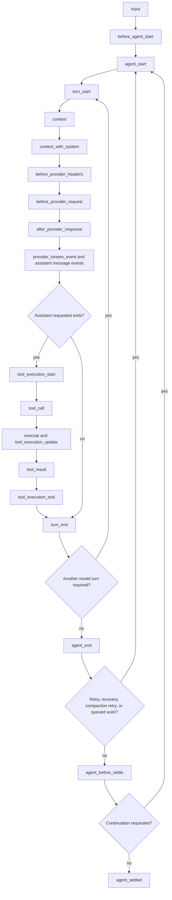
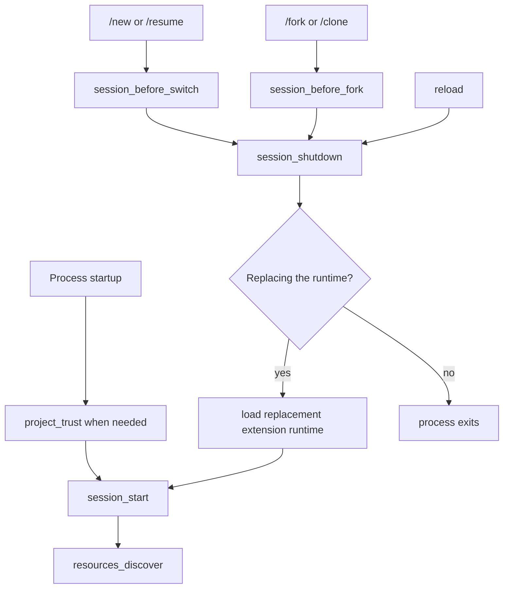

# Extensions

Extensions add executable behavior to PiG. They can register tools, commands, event handlers, providers, renderers, and interactive UI.

PiG preserves the Pi extension model while using a process-oriented host that supports Go, Rust, Python, and Node. A compatible Go extension can also be compiled into a Piglet Binary.

## Why PiG uses this design

Upstream Pi loads TypeScript extensions in process. PiG is a Go-native implementation and does not embed a JavaScript runtime or load dynamic Go plugins.

PiG instead uses one public extension contract with several execution realizations:

- isolated subprocess;
- packed subprocess cell;
- fused Go factory in a Piglet Binary.

This design has four goals:

1. Preserve observable Pi extension behavior.
2. Support several implementation languages.
3. Isolate source extension failures where practical.
4. Allow reviewed Go extensions to become part of one native agent executable.

Execution placement must not change extension behavior. An extension uses the same registration and host-call contract in source, packed, and fused modes.

## Known cross-process gaps

Three cross-process differences remain: the Provider object surface and foreign configuration identity (D78), partial-message observation (D82), and event-bus scheduling boundaries across processes (D83). See [Providers](/docs/latest/providers) and [RPC mode](/docs/latest/rpc).

Every Node extension shares one `pi.events` bus, including explicitly isolated extensions and exact standalones. A listener in another process receives the emitter's original payload by reference: synchronous mutations, reentrant emits, retained and post-await aliases, and callbacks behave as in Pi. D83 names what differs across processes: independent tasks in different processes are ordered by timing, only a listener's first post-await continuation is ordered with the emitter's microtasks, reference cycles that cross processes are released when a process exits, and brand checks such as `util.types.isMap` fail on a foreign object, where `util.types.isProxy` also returns true. `util.inspect` with `customInspect: false` prints an empty placeholder object instead of a foreign payload, `util.inspect` with `showProxy: true` shows the Proxy wrapper, and on Node 26.0.0 and later `util.inspect` of a non-extensible foreign payload prints it inside `Proxy(...)`, because V8 offers no hook. Node 25 and earlier print that payload as Pi does. A listener that never returns blocks its emitter, as in Pi.

Same-process configuration roots, children, callbacks and receivers must also remain Pi-exact. A foreign configuration snapshot is not a live author-held object (D78). A retained remote partial message does not advance with its producer (D82). Event order, cancellation, final results, persistence and cleanup remain required. The strict RPC33 comparison retains its raw failure.

## Extension responsibilities

An extension owns one executable capability or a cohesive group of capabilities. It can contribute:

- model-callable tools;
- slash commands;
- lifecycle handlers;
- provider and OAuth declarations;
- message and entry renderers;
- status, widget, header, login, and focused UI;
- extension-owned namespaced state.

An extension does not select itself. Settings, a Package, an explicit `-e` path, or a Piglet selects it.

## Supported source forms

PiG accepts one conventional factory or one exact standalone source.

| Language | Factory | Standalone |
|---|---|---|
| Go | `func Extension() *sdk.Extension` | Executable `package main` module |
| Rust | `pub fn new_extension() -> Extension` in `src/lib.rs` | Crate with `src/main.rs` |
| Python | `def new_extension() -> Extension` in one module | Executable `main.py` with a shebang |
| Node | Pi-compatible default export | Executable script with a shebang |
| Native | Not applicable | Exact executable file |

PiG rejects mixed languages, multiple factories, factory and standalone combinations, nonstandard factory symbols, missing entry points, and identity mismatches.

## Create an extension

Prefer Go for an extension that may become part of a native Piglet Binary:

```bash
pig extension init ./review --lang go
```

Create an isolated standalone only when the capability needs its own executable boundary:

```bash
pig extension init ./review --lang go --isolated
```

The scaffold does not write an extension manifest. Runtime registration is the source of extension identity and capabilities.

## Understand the runtime lifecycle

The factory can be synchronous or asynchronous. PiG waits for an asynchronous factory before startup continues, allowing it to fetch configuration or register providers needed during startup.

Do not start processes, sockets, watchers, or timers in the factory because some invocations load extensions without starting a session.
Start long-lived resources from `session_start` or from the command or tool that needs them.
Close session-scoped resources from an idempotent `session_shutdown` handler.

A normal prompt follows this hook sequence:



The lifecycle involves these event groups:

| Area | Events |
|---|---|
| Input preparation | `input`, `before_agent_start` |
| Agent run | `agent_start`, `agent_end` |
| Model turn | `turn_start`, `context`, `context_with_system`, `turn_end` |
| Provider call | `before_provider_headers`, `before_provider_request`, `after_provider_response`, `provider_stream_event` |
| Message lifecycle | `message_start`, `message_update`, `message_end` |
| Tool execution | `tool_execution_start`, `tool_call`, `tool_execution_update`, `tool_result`, `tool_execution_end` |
| Settlement | `agent_before_settle`, `agent_settled` |

PiG counts as busy while a run starts, including the compaction check and `before_agent_start`, so messages sent meanwhile go into the starting run. Message lifecycle events also cover user and tool-result messages; the diagram places only the assistant stream where it occurs in each model turn.

Tool hooks run for each tool call, and one assistant response can start another turn by returning tool calls. Provider hooks run only when that transport exposes the corresponding stage. See the exported declarations in Pi's [`extensions/types.ts`](https://github.com/earendil-works/pi/blob/main/packages/coding-agent/src/core/extensions/types.ts) for exact event payloads and result types; PiG delivers the same events to subprocess and fused extensions.

Session startup and replacement follow a separate lifecycle:



`project_trust` runs before trusted project resources load and can run again when session replacement enters a new working directory. Retries, recovery, compaction, and queued messages can start another agent run after `agent_end`, so `agent_end` is not a final-idle signal. Reload and session replacement invalidate the old runtime. Code after `await ctx.reload()` still belongs to the old runtime and must not reuse its session-bound state.

### Choose an event by intent

| Goal | Event |
|---|---|
| Inspect, transform, or consume raw user input | `input` |
| Change prompt sections, active tools, or add context before a run | `before_agent_start` |
| Observe one low-level agent run | `agent_start`, `agent_end` |
| Act after one model response and its tool calls | `turn_end` |
| Filter conversation messages for one provider request | `context` |
| Transform the complete transcript, including system messages | `context_with_system` |
| Change request headers or the serialized provider payload | `before_provider_headers`, `before_provider_request` |
| Observe provider response metadata or parsed stream events | `after_provider_response`, `provider_stream_event` |
| Authorize or modify a tool call | `tool_call` |
| Redact, annotate, or replace a tool result | `tool_result` |
| Append final entries or request one last continuation | `agent_before_settle` |
| Run notification work after automatic processing has stopped | `agent_settled` |
| Initialize or release session-scoped resources | `session_start`, `session_shutdown` |

<a id="agent_start--agent_end--agent_before_settle--agent_settled"></a>

Use `agent_before_settle` when an extension must append entries or request one final continuation. Use `agent_settled` for notification-only work that should run after Pi has no automatic continuation remaining.

<a id="extensionapi-methods"></a>

## Validate without installing

```bash
pig install ./review --validate-only --json
```

Validation:

- resolves the source form;
- builds or starts the extension;
- checks runtime registration;
- verifies identity;
- detects duplicate capabilities;
- reports placement;
- changes no Package settings.

Validate a set to find conflicts before using it in a Piglet:

```bash
pig install --validate-only --set ./review,./policy --json
```

## Select an extension

Use an explicit path for a temporary source run:

```bash
pig -e ./review
```

Use a Piglet for an agent application:

```yaml
extensions:
  - name: review
    origins: [local:./extensions/review]
```

Use a Package when you need to distribute the extension to other applications. Installing the Package does not activate a Piglet.

## MCP servers, virtual models and tool exposure

An extension in any supported language can register MCP servers (`registerMcpServer`), virtual models (`registerVirtualModel`) and tools with `exposure`, `namespace`, `annotations`, `outputSchema`, `defaultActive`, `prepareLoadout` and `reachesTools`, and a tool can call other tools through `ctx.executeTool()`. `prepareLoadout` receives each tool's prompt guidelines (`getPromptGuidelines`); the default system prompt leaves hidden tools out of its tool list and rules, and names no tool in the skills hint when the file reader is hidden. See [MCP servers](mcp.md#extensions), [virtual models](virtual-models.md) and [codemode](codemode.md).

A tool that reaches other tools, such as `codemode` or `tool_search`, declares which ones a call may reach with `reachesTools(input)`. It returns `"all"`, or the words of the input that may name tools. A word refers to every tool or namespace whose name contains it. `pi.getAllTools()` reports `reachesTools` for each tool. Pi 1.4.0 added `reachesTools`.

`namespace: { name, aliases, description, instructions }` groups related tools, as MCP servers do. Codemode lists a namespace under one heading with its `description`. `instructions` holds longer usage guidance, such as MCP server instructions. It is not listed, and codemode scripts read it with `describeNamespace(name)`. `aliases` are other names that `describeNamespace()` and the `namespace` option of `searchTools()` accept, such as the server name `docs` for `mcp__docs`. Pi 1.4.0 added `aliases`. A server config given to `registerMcpServer` accepts the same `description` as an `mcpServers` entry in `mcp.json`.

## Markdown transformers

Register a display-only Markdown transformer with `pi.registerMarkdownTransformer` in Node, `MarkdownTransformer` in Go, or `markdown_transformer` in Rust and Python. Transformers receive the message type, streaming state, and current content width. They change the displayed user, assistant, and visible-thinking text, not the stored message or provider input. A string replaces the current Markdown, including an empty string. Node Promise results and other non-string results are ignored, as in Pi.

`pi.registerToolRenderer((toolName, next) => renderers)` in Node, `ToolRenderer` in Go, `tool_renderer` in Python and Rust (`Context::register_tool_renderer` after loading in Rust) chooses renderers for calls to any tool, including tools that are not registered yet, such as MCP tools in a resumed session before their server connected. `next()` returns what the remaining resolvers (in extension load order), then the registered tool, would use, so `next() ?? mine` only fills in. PiG asks an extension's resolvers once per tool, off the interactive loop: until the answer arrives, a card draws with `next()`'s renderers, and `next()` is a marker that a resolver can return but whose render functions it cannot call; a copy of it given a call or result renderer draws with only the renderers the resolver set (D89).

PiG runs the complete chain off the render loop through its multi-language bridge (D19). Normal updates preserve render-admission order across components. A replacement discards obsolete output without ending an admitted callback's wait early. Equal-text content updates rerun stateful transformers. Removing a message removes its queued work and prevents late publication.

Renderer inactivity, disconnect, and shutdown retain the subprocess isolation boundary (D56). Cancellation of a host request does not prove that the extension callback body has returned. Keep synchronous transformers short and do not depend on side effects from an abandoned callback.

## Final tool-result content

Return an ordered `content` array when a tool produces text and images. Each text block uses `{ "type": "text", "text": "..." }`. Each image block uses `{ "type": "image", "data": "...", "mimeType": "image/png" }`, where `data` contains base64-encoded image bytes.

PiG preserves the blocks and their order in final tool events, provider context, Session history, and custom-renderer input. An empty text block remains distinct from `content: []`. Text signatures remain attached to their text blocks.

After `tool_result` handlers run, PiG normalizes images before storing the result. A conversion or resize note appears immediately after the affected image. Disabling `images.autoResize` prevents resizing but still permits conversion of unsupported formats, such as BMP, to PNG. If image processing fails, PiG retains the original image block instead of dropping tool output.

## Subprocess realization

Source extensions normally run through PiG's subprocess host.

### Advantages

- Supports Go, Rust, Python, Node, and native executables.
- Separates many crashes and exits from the PiG process.
- Provides explicit heartbeat and cancellation handling.
- Supports source development and reload.
- Avoids unsafe dynamic native plugin loading.

### Costs

- Adds process startup and IPC overhead.
- Requires serialization at the process boundary.
- Can require a language runtime or compiler on first source build.
- Requires explicit lifecycle, timeout, and connection handling.
- Cannot transfer live Go or TypeScript object closures across the wire.

## Packed subprocess cells

Compatible factories in one language can share a generated runtime process. Each extension keeps its own logical connection and registration.

Packing reduces process count. It does not create a shared extension identity. Copies selected from distinct folders retain their original registration names and separate host identities. Go copies with the same module path build in separate cells so each runs its own source (D20). Tool and flag conflicts are reported after loading, as in Pi.

Cold native builds print `Building extensions...` only in interactive mode with a terminal stderr (D19). Cached builds, Node loads, print, JSON, and RPC do not print this notice.

A stalled logical member is isolated from healthy members where the process remains healthy. If the shared process dies, PiG quarantines the affected cell. The next plan can separate failed members from healthy members.

## Fused Go realization

A Piglet Binary can compile a compatible Go factory into the PiG executable.

### Advantages

- Produces one target-native executable.
- Removes target-side Go build requirements.
- Avoids extension subprocess startup.
- Keeps exact extension source in the Binary build closure.

### Costs

- Requires a Binary rebuild for every extension change.
- Shares PiG's process failure boundary.
- Requires a target-specific build.
- Supports compatible Go factories only.
- Needs stricter panic, deadlock, and resource-lifetime review.

Fusion is a delivery optimization. Fused factories use the same registration and host-call semantics as subprocess factories.

## Session compaction events

Register `session_before_compact` to inspect or replace compaction work. The event contains the preparation, branch entries, custom instructions, reason, retry state, and cancellation context. Return `cancel: true` to cancel the operation. Return `compaction` to provide the result without a model call.

PiG persists a successful result before it emits `session_compact`. The event contains the persisted compaction entry, reason, retry state, and `fromExtension` value. Isolated, packed, and fused extensions receive the same events.

A `session_compact` handler that calls `sendMessage({ triggerTurn: false })` during an overflow recovery has its message appended before the interrupted turn retries, so the retry sees it. Pi defers the message to the end of the run, after the retry (D138, Pi #9051).

PiG emits `session_compact_failed` after a compaction fails or is aborted, once the `compaction_end` listeners have returned. The event contains the reason, `errorMessage` (absent when the compaction was aborted), `aborted`, retry state, and `fromExtension` value.

PiG Standard requires every selected extension to fuse:

```yaml
build:
  extensionRealization: fused
```

A Standard Binary build fails if any selected extension would use a subprocess.

## Connection and liveness model

PiG cannot guarantee that an extension connection never fails. An extension process can crash, be killed, deadlock, exhaust a resource, or lose its transport.

PiG instead provides a bounded failure contract:

1. Detect transport or heartbeat failure.
2. Cancel pending calls owned by the failed connection.
3. Close UI and renderer state owned by that connection.
4. Isolate or quarantine the affected member or cell.
5. Preserve unrelated healthy extensions where possible.
6. Keep the previous working extension set when a replacement fails validation.
7. Permit an explicit reload or supervised restart when safe.

A heartbeat proves that the transport dispatcher is alive. It does not prove that an extension handler is making progress.

Tools, commands, events, and shortcuts can perform long operations until they finish or are cancelled. Renderers use generation-scoped inactivity and retain the last valid frame when a new generation stalls.

When a run aborts while an extension tool runs, PiG cancels the tool's request, so its abort signal fires (Node `AbortSignal`, Go `ctx.Done()`, Rust and Python `is_cancelled`). A tool that settles within 3 seconds behaves as in Pi. A tool that has not settled by then fails with `Operation aborted`, the session is free again, and the tool's late answer is discarded. Pi waits for such a tool indefinitely (D111).

An extension's standard error goes to its diagnostic log. The log keeps the first 1 MiB and the last 64 KiB of the output and states how many bytes it dropped. When an extension in a shared Go, Rust or Python process crashes, the error for each stopped extension says that `/reload` restarts it.

## Custom messages

`pi.sendMessage(message, options)` uses the current Session in print, JSON, and RPC as well as interactive mode. An idle message with `triggerTurn: false` is persisted without starting a model turn. RPC emits its `message_start` and `message_end` before acknowledging the command that sent it. `deliverAs: "nextTurn"` defers delivery until a later prompt. Preserve omission of `triggerTurn` separately from explicit false when a run is active. The Session owns triggered work and shutdown; the bridge does not create another run owner.

A run that `sendMessage({ triggerTurn: true })` starts while idle checks compaction, emits `before_agent_start`, applies its result, and delivers pending `nextTurn` messages before it starts. The event's `messageType` is `"custom"`, with `message` and no `prompt`; a user prompt has `messageType: "user"`. A handler that should act only on user prompts must check `event.messageType === "user"`. Pi 1.4.0 does the same; Pi 1.1.0 skipped these steps for such a run ([Pi #5581](https://github.com/earendil-works/pi/issues/5581)).

The Session counts as busy from the moment a run starts, including while `before_agent_start` handlers run. During that time `ctx.isIdle()` returns false, `pi.sendMessage()` queues into the starting run, `pi.sendUserMessage()` requires `deliverAs`, and an abort aborts the run once it starts. This follows Pi 1.4.0. In Pi 1.1.0 a second `sendMessage` could start another run, which failed with "Agent is already processing" ([Pi #10739](https://github.com/earendil-works/pi/pull/10739)).

Clearing the queue (RPC `clear_queue`, the SDK, or the interactive restore-to-editor key) removes only queued user messages. Custom messages that an extension queued with `deliverAs: "followUp"` or `"steer"` stay queued. Pi drops them without notice (D135, Pi #9886).

A `waitForIdle()` call made during a run stays pending until the `agent_settled` handlers and every prompt they deferred have finished. An abort during settlement discards the deferred prompts. Pi resolves the waiter earlier and still starts a deferred prompt after an abort (D142, Pi #10704, #10705).

## Session context

PiG loads session history for an extension only when the extension reads it. A persisted session is read from its local JSONL file and reconciled with the host cursor. If the file is unavailable, the host sends ordered pages of at most 4 MB. Later appends use the same bounded path.

## Why PiG does not replay interrupted operations

If a connection fails during a tool call or command, that operation fails. PiG does not automatically replay it.

A replay could repeat:

- a file mutation;
- a shell command;
- a network request;
- a user message;
- an external transaction.

PiG cannot infer that these effects are idempotent. The caller must decide whether retry is safe.

An extension must persist durable state before it needs that state after restart. PiG cannot recover state that existed only in the failed process memory.

## Reload behavior

`/reload` uses the same normalized extension inputs and first-seen order as startup.

PiG:

1. resolves the requested extension set;
2. computes content identity and reuses valid build artifacts;
3. plans runtime cells;
4. constructs a fresh factory and runtime for every configured, embedded, fused, and built-in extension;
5. starts and validates replacements;
6. verifies registration;
7. publishes the successful set;
8. shuts down the old set.

A failed extension is removed and reported while other extensions load.

If a Node factory throws or rejects, its captured `pi` API becomes inactive. Later registration, action, getter, and event-bus calls throw `Extension "<path>" failed to load and its API is no longer active.` synchronously, even when the method normally returns a Promise. Event-bus subscriptions made by that factory are removed. Healthy extensions keep their APIs.

Node extensions keep Jiti's compiled-source cache under `<config-root>/cache/jiti` (D20). The loader checks source contents on each load and separates compiler and runtime versions, so a changed source is compiled again. Changing the temporary directory does not discard this cache. The cache does not retain evaluated factories between loads. `JITI_FS_CACHE=false` disables it. The transform cache is disposable and is separate from the published artifacts managed by `pig extensions cache prune`.

Node also keeps native bytecode under `<config-root>/cache/node-compile` when a virtual SDK library is imported (D20). Node validates source bytes and VM compatibility before reuse. This cache contains compiled code, not evaluated factories or extension state. `NODE_DISABLE_COMPILE_CACHE=1` disables it independently of Jiti. Existing Node cache configuration remains authoritative. Like the Jiti cache, it is disposable and is not managed by `pig extensions cache prune`.

## Session replacement

`/new`, `/resume`, `/fork`, `/clone`, `ctx.newSession()`, `ctx.fork()`, `ctx.switchSession()` and the RPC commands `new_session`, `switch_session`, `fork` and `clone` build the replacement Session's extensions from scratch: a new runner, new extension processes and a new `session_start`. PiG starts a fresh process where Pi calls the extension factory again inside the same Node process, so module-level state and process-wide state such as `process.env` do not carry over to the next Session (D70). The extension that requested the replacement keeps its process until its command handler returns. A `ctx` that an extension captured before a replacement or reload raises Pi's stale message from `cwd`, `mode`, `hasUI` and `model`, as Pi throws it: Go and Rust panic with the message, and Python raises `RuntimeError`. The handler's error carries the message. Host calls through such a `ctx` or `pi` are rejected with the same message without throwing at the call site: the SDK returns or raises an error or writes it to stderr, depending on the language (D30).

## Cancellation

A handler receives request cancellation through its language SDK.

In Go, use `sdk.Context.Done()` and return the cancellation error from owned work. Do not detach a goroutine from the handler unless the upstream operation is intentionally unawaited and another lifecycle owns it.

An awaited handler must return only after its work finishes. Returning early changes completion ordering and loses errors.

Python custom-provider callbacks and the SDK's event forwarding share the request Context's cancellation signal. Check `ctx.is_cancelled()` while doing provider work. Cancellation before forwarding, during iteration, or after the iterator ends produces an aborted-operation error instead of forwarding further events.

Interactive shutdown cancels and joins its input reader and decoder before stopping the renderer or restoring the terminal. Temporary dialogs keep the shared input owner alive. External-editor handoffs pause the terminal reader without closing stdin, so the next owner can receive unread input.

## Retained callback contexts

A callback may retain its extension Context after its originating command or event handler finishes normally. Later host calls use the same live extension connection, not the completed request. This applies to retained terminal-input callbacks that read current editor text and tool-expansion state, including empty/reset values. Editor text includes the full contents of compact pastes, not their `[paste #…]` markers. Node callbacks receive the same owner-published expanded text that host-query SDKs read.

Keep cancellation and connection retirement separate from normal completion. A cancelled originating request does not become a new runtime-owned request. Calls through a closed or replaced connection fail; they do not move to the latest handler or a replacement connection. Obtain a fresh Context after reload or Session replacement. Await work that belongs to the current handler instead of detaching it and relying on a retained Context to keep it alive.

These lifetime rules belong to the multi-language bridge (D19). They do not replay interrupted operations or change the renderer inactivity policy (D56).

## Terminal strings

Terminal listeners receive JavaScript UTF-16 strings. A printable character outside the BMP can arrive as separate high- and low-surrogate chunks, with an unmatched unit visible in the editor between them. Do not join chunks before returning a verdict. The wire uses valid JSON `\u` escapes for unmatched units.

PiG's interactive driver owns terminal input. It runs the host's color and cell-size replies, the overlay fix-up and the host listener chain for each input chunk first, in Pi's order. An extension's terminal-input listener runs after them, asynchronously, and PiG keeps each chunk's place in the input order. In Pi the listener runs synchronously inside `TUI.start()`'s input handler (D105).

Go SDK strings use the native editor's WTF-8 convention for unmatched units. Use `github.com/MichaelKinsy/PiG/extensions/sdk/json` instead of `encoding/json` when serializing callback text yourself. Node and Python strings retain these units naturally. Rust terminal and focused-component input callbacks receive `&JsString`, verdict `data` is `Option<JsString>`, and `get_editor_text` returns `JsString`. Use `as_units()` for lossless access, `from_units(...)` to construct a string, and `to_string_lossy()` only for display. Rust editor setters accept ordinary strings or `JsString`.

## Registration inputs

Every tool must supply an object parameter schema, including a tool with no arguments. Use an empty object schema rather than omitting the schema or passing null. Invalid schemas fail before registration changes; a later valid declaration does not hide an earlier invalid one.

Flag values preserve false and empty strings. Clearing an override restores its registered default instead of keeping a stale value in an SDK snapshot.

Provider configuration is validated before it replaces an existing registry entry. Supply `api` with a `streamSimple` callback and supply an API at the provider or model level for each new model. A failed registration does not remove the previous provider. See [Provider extensions](/docs/latest/providers#provider-extensions) for binding and removal behavior.

## Focused UI

A subprocess extension can open focused custom UI. The extension renders local line snapshots. PiG owns the focus shell and sends ordered input back to the component.

One terminal gives focus to one extension dialog or overlay at a time. Other interactive calls wait outside the TUI loop. Cancellation removes a waiting call before it takes focus.

A component opened as an overlay renders at the overlay's width, as in Pi: 80 columns or the available width, whichever is smaller, unless `overlayOptions` sets `width`, `minWidth` or `margin`. An inline component and a legacy titled modal (`title`, `widthFraction` or `heightFraction` without `overlayOptions`) render at the terminal width.

Timer-driven render requests are available in Go, Rust, Python, and Node. PiG coalesces repeated requests, limits them to the 16 ms TUI frame interval, and sends only changed snapshots. Input-driven frames remain immediate.

A component opened with `ctx.ui.custom` receives mouse events in fullscreen mode, as in Pi: clicks, presses, drags, wheel and hover, with coordinates local to the component. Implement Pi's `handleMouse` in Node, `sdk.MouseHandler` in Go, and `handle_mouse` in Rust and Python. Select and settings lists in component-kit views respond to clicks and the wheel.

The host rejects stale-width, out-of-order, and late-generation frames. The SDK detaches timer invalidation before it disposes the component. Completion, cancellation, reload, disconnect, and shutdown stop component work. A callback that does not return causes a bounded cleanup error instead of concurrent disposal.

PiG Standard includes PiG Runner as an ordinary Go extension. `/runner` and `/pig-runner` use the same public custom-component contract as any other extension. A Standard Binary fuses the extension without a private Stock PiG launcher.

## User bash operations

A `user_bash` handler can return Pi's `{ operations }` result in every SDK, for example to run `!` commands over SSH. The `BashOperations` object stays in the extension. The host runs the user's command through its `exec` with `onData`, `signal`, `timeout` and `env`. Node returns Pi's object as is, Go returns `map[string]any{"operations": sdk.BashOperations{Exec: ...}}`, Python returns an object with an `exec` method, and Rust returns `ctx.bash_operations(...)`.

## Tool render context

Tool renderers receive `outputPad` (`context.outputPad` in Node, `OutputPad` in Go, `output_pad` in Rust and Python) and `durationMs`, the milliseconds the tool's `execute` took. A renderer with `renderShell: "self"` applies `outputPad` itself. `ctx.ui.theme.sourcePath` reports the active theme's own source file.

## Extension-owned state

Store product or extension state below a namespaced path:

```text
~/.pig/state/<extension-id>/
```

Do not add product state fields to Stock PiG settings.

PiG Standard's login extension follows this rule for sprite selection.

## Product boundary

Keep product behavior outside Stock PiG. A product extension can provide branding, onboarding, authentication, marketplace access, or workflow commands through public extension and Piglet contracts.

Do not add a product-specific launcher, startup branch, or hidden registration to `cmd/pig`.

## Security model

Extensions run with the permissions of the PiG process unless an operating-system boundary limits them. Process separation improves failure isolation but is not a security sandbox.

Before you install an extension:

- review its source and dependencies;
- verify its origin and digest;
- understand its required files, commands, network access, and secrets;
- use a container or virtual machine when you need a security boundary.

## Upgrade a Go extension written for an older SDK

PiG compiles a Go extension against the SDK of the pig that runs it, so an SDK release can break an extension written for an earlier one (D109). Pi has no equivalent: it loads extension source in process. When a build fails on a changed SDK symbol, pig reports `go build: written for an older SDK` and names each changed API with its old and new shape, instead of printing only the compiler log:

```text
Extension "ask" was written for an older SDK:
  Context.GetSessionID: func() string -> func() (string, error) (SDK 0.3.0)
  SendMessageOptions.TriggerTurn: bool -> *bool (SDK 0.2.0)
Run: pig extension upgrade /home/me/.pig/agent/extensions/ask
```

A build that also fails on an error that is not an SDK change, in the extension or in another extension of the same packed cell, keeps the plain build message.

`pig extension upgrade [<name|path>...] [--all] [--dry-run] [--summary]` rewrites the extension with the rules in `extensions/sdk/upgrade`. The rules parse and type-check the Go source, edit only the SDK uses they recognize, and format the result with `go/format`. The command copies the original files to `<config root>/state/extension-upgrade/<time>-<name>/` first (`<time>-<name>-2/` and so on when that directory exists), prints a unified diff, rebuilds the extension, and reports one status per extension: `upgraded`, `up to date`, `needs manual changes`, `failed` or `skipped`. `--dry-run` prints the diff and changes nothing. `--summary` prints one line per extension. With no argument, the command upgrades every Go extension that settings, packages, the agent directory and a trusted project directory load.

Before, written for SDK 0.2.0:

```go
ext.OnSessionStart(func(ctx sdk.Context, _ map[string]any) (any, error) {
	id := ctx.GetSessionID()
	return nil, ctx.SendMessage("note", id, true, sdk.SendMessageOptions{TriggerTurn: true})
})
```

After `pig extension upgrade`:

```go
ext.OnSessionStart(func(ctx sdk.Context, _ map[string]any) (any, error) {
	id, err := ctx.GetSessionID()
	if err != nil {
		return nil, err
	}
	return nil, ctx.SendMessage("note", id, true, sdk.SendMessageOptions{TriggerTurn: sdk.Bool(true)})
})
```

The rules rewrite the host-backed getters, the optional boolean fields, and `ContextUsage.Tokens` and `Percent`. A getter call moves out of its statement, including an `if` or `switch` init statement, together with any `Cwd`, `Mode`, `HasUI`, `Width`, `Height` or `ToolCallID` call before it so the calls keep their order. A `ConfigHome` call that is the only argument of a variadic call, such as `fmt.Println(ctx.ConfigHome())`, still compiles because its value and its error both become arguments, so the error is printed or passed on instead of handled. When the extension's `go.mod` requires an SDK older than 0.5.0, the rules find that call and rewrite it the same way, and list it rather than discard its error. A call whose parameter for the error has the type `error`, such as `check(home string, errs ...error)`, already receives the error and stays. A function that returns an error returns the getter's error. In a function that does not, a host-backed getter's error is discarded with a comment, which keeps the old SDK's empty value on failure, while a `ConfigHome` call is listed for you instead: the old `ConfigHome` could not fail, and an empty configuration root would make its paths relative to the working directory. A use that cannot move without changing the order of evaluation, such as one in a `select` case, and a getter's method value passed where the old signature is wanted, are listed with the reason. A change with no safe rewrite, such as the typed `SetEditorComponent` factory, the `ToolConstrainedSampling` union, the `AutocompleteProviderFactory` type or a provider object's `*sdk.Credential`, is reported with its remedy and the file stays as it was. An upgrade is all or nothing: if writing a file or the rebuild of the upgraded extension fails, pig restores every file it changed and the report says so.

Interactive startup lists a drifted extension and asks `Run pig extension upgrade <path>... now? [y/N]` before it exits. Yes upgrades and rebuilds them, then loads the extensions again in the same process and continues startup, so a `--fork`, `--session-id` or `--name` takes effect once. No exits as Pi does on an extension load error. Print, JSON and RPC modes print the command to standard error and exit 1, and write nothing to standard output.

Set `extensionsAutoUpgrade` to `true` in the global settings file to run the rules at startup and after `pig update` without the question. Each upgraded extension gets a backup and one line on standard error. The setting is off by default, a project settings file cannot turn it on, and only the rules run; no agent edits an extension.

When two loaded extensions register the same tool and one directory is a copy of the other, pig names both directories and suggests removing the older copy. Pi's tool-conflict error stays as it is.

## SDK changes in 0.5.0

These SDK changes break extensions written for 0.4.x. `pig extension upgrade` rewrites each Go change that has a safe rewrite and reports the others with their remedy (see [Upgrade a Go extension written for an older SDK](#upgrade-a-go-extension-written-for-an-older-sdk)).

- `Context.SetEditorComponent` in the Go SDK takes an `sdk.EditorFactory` instead of `any`. The old `any` form accepted only nil.
- The configuration-root getter can fail. Go `Context.ConfigHome` returns `(string, error)`, Python `config_home` raises `RuntimeError`, and Rust `Context::config_home` returns `io::Result<String>`, each when the home directory is needed and unavailable. The Rust SDK no longer reads `GOPI_HOME`; set `PIG_HOME` instead.
- A provider object's `OAuthAuth.Login` takes the app's login options as its second argument, and a Go provider's credential is `*sdk.Credential` instead of `map[string]any`. See [Custom providers](/docs/latest/custom-provider).
- `ProviderStreamOptions` gains `OnProviderStreamEvent` (`on_provider_stream_event`) and loses `TransformHeaders` (`transform_headers`) in Go, Python and Rust.
- Rust `on_event` and `on_event_result`, and Python `on_event`, lose the `can_block` argument. Pi has no such concept, and the host never read it.
- The subprocess wire type `CommandDecl` has no `Args` field. Pi's `registerCommand` has no such option.

An extension that fails while registering shows its own error in the load message, also when its process has just exited. A Rust panic is reported with its message.

## Go SDK changes in 0.3.0

Pi 1.4.0 represents unknown context usage as null, not zero. Go therefore keeps `ContextUsage.Tokens` as `*int` and `Percent` as `*float64`. `GetContextUsage()` returns nil when there is no usable model window, and a host failure as an error in every SDK (Go `error`, Rust `io::Result`, Python `HostCallError`). After compaction, a non-nil usage can contain nil counts. Rust uses `Option`; Python uses `None` for the same states.

Before:

```go
if usage != nil && usage.Tokens > 0 {
    fmt.Printf("%d tokens (%.1f%%)", usage.Tokens, usage.Percent)
}
sdk.SendMessageOptions{TriggerTurn: true}
```

After:

```go
if usage != nil && usage.Tokens != nil && usage.Percent != nil {
    fmt.Printf("%d tokens (%.1f%%)", *usage.Tokens, *usage.Percent)
}
sdk.SendMessageOptions{TriggerTurn: sdk.Bool(true)}
```

Use `usage.TokensOr(0)` or `usage.PercentOr(0)` only when the caller intentionally selects zero for unknown usage. Check `usage != nil` first. The helpers do not change the nullable fields. `sdk.Bool(false)` explicitly selects false; nil leaves an option unset. For `TriggerTurn`, unset steers during an active turn while false defers the custom message. Do not replace omitted options with false automatically. These helpers are Go ergonomics for the shared SDK contract (D19).

### Host-backed getters report failures and Pi's undefined

Pi's getters throw when the host call fails and return `undefined` for absent state. Every SDK now does the same: a failure is an error, never an empty value, an assumed default or a cached name. Pi's `undefined` is a nil pointer in Go, `Option::None` in Rust and `None` in Python.

Go `Context` methods (each returns the error last):

| Method | Before | After |
|---|---|---|
| `GetEditorText` | `string` | `(string, error)` |
| `GetSessionName` | `string` | `(*string, error)`, nil when unnamed |
| `GetSessionID` | `string` | `(string, error)` |
| `GetSessionFile` | `string` | `(*string, error)`, nil for an in-memory session |
| `GetLeafID` | `string` | `(*string, error)`, nil for an empty session |
| `GetFlag` | `any` | `(any, error)`; a failure no longer answers the registered default |
| `GetThinkingLevel`, `GetSystemPrompt`, `GetToolsExpanded` | value | `(value, error)` |
| `GetActiveTools`, `GetAllTools`, `GetCommands`, `GetAllThemes` | slice | `(slice, error)` |
| `GetSystemPromptOptions` | `SystemPromptOptions` | `(SystemPromptOptions, error)`; collections are always present |
| `GetContextUsage`, `GetModelInfo` | pointer | `(pointer, error)`, nil when absent |
| `GetModelAuth` | `json.RawMessage` | `(json.RawMessage, error)` |
| `IsIdle`, `HasPendingMessages`, `IsProjectTrusted` | `bool` | `(bool, error)`; no assumed idle or trusted state |
| `GetBranch`, `GetEntries` | slice | `(slice, error)`; a failed session-log subscription is returned on every read |

Rust `Context` methods return `io::Result<T>` (`io::Result<Option<T>>` for `get_session_name`, `get_session_file`, `get_leaf_id`, `get_flag`, `get_context_usage` and `get_model_info`); `get_branch` and `get_entries` return `io::Result<Vec<_>>`. Python methods raise `HostCallError`; `get_session_name`, `get_session_file` and `get_leaf_id` return `None` when absent, and `get_branch` and `get_entries` raise the subscription failure.

### Timeouts are JavaScript numbers

Pi's exec and dialog `timeout` is a number, so fractional and very large values are meaningful. Go `ExecOptions.Timeout` and `DialogOptions.Timeout` change from `int` to `float64` (an `int` variable no longer compiles; convert it). Rust `ExecOptions.timeout` and `DialogOptions.timeout` change from `Option<u64>` to `Option<f64>`, and both types lose `Eq`. Python accepts a float. Exec timeouts and interactive dialog countdowns start only for a positive value, as in Pi. In RPC mode a dialog arms Node's timer for any non-zero value, negative included (rpc-mode.ts), and a timed-out dialog resolves like a cancelled one: `undefined` for select and input, `false` for confirm.

### System prompt options

`getSystemPromptOptions` returns Pi's collection-complete shape: `selectedTools`, `toolSnippets`, `toolGuidelines`, `promptGuidelines`, `appendSystemPrompt`, `sections`, `contextFiles` and `skills` are always present, empty when unset. Go `SystemPromptOptions` gains `ToolGuidelines`.

Legacy `github.com/mainstai/pig/extensions/sdk` imports remain buildable in factories and exact standalones. PiG creates a private alias of the current SDK, including its subpackages and self-imports, without editing authored files (D19). Use the current `github.com/MichaelKinsy/PiG/extensions/sdk` path for new or fused extensions.

## Replace the editor

An extension replaces the input editor with `setEditorComponent` and reads its own replacement back with `getEditorComponent`, as in Pi. Every runtime has both calls and they behave alike:

| Runtime | Install | Read back |
|---|---|---|
| Node | `ctx.ui.setEditorComponent(factory)` | `ctx.ui.getEditorComponent()` |
| Go | `Context.SetEditorComponent(factory sdk.EditorFactory) error` | `Context.GetEditorComponent() any` (a non-nil result is an `sdk.EditorFactory`) |
| Rust | `Context::set_editor_component(factory)` | `Context::get_editor_component() -> Option<EditorFactory>` |
| Python | `Context.set_editor_component(factory)` | `Context.get_editor_component()` |

The factory receives the host's default editor, which the component embeds as its `super`. A nil or `undefined` factory, or the SDK's clear call, restores the host's editor. The getter returns the factory this extension installed last. It returns nothing before an install, after the editor is cleared, with no UI, and in RPC mode, where installing does nothing, as in Pi. It never returns another extension's factory.

## SDKs

PiG ships subprocess SDK bridges for:

- Go: `extensions/sdk`;
- Rust: `extensions/sdk-rs`;
- Python: `extensions/sdk-py`.

Node extensions use Pi-compatible exports through the Node runtime bridge. The `extensions/sdk-ts` package re-exports the pinned Pi types and declares PiG-only calls. It contains no runtime implementation.

Runnable examples for each language are in `examples/extensions/`: `go-factory`, `rust-factory`, `python-factory` and `node-factory`.

All runtime bridges target the same current extension behavior. A new capability is incomplete until each supported runtime exposes equivalent behavior and the conformance suite can detect a broken implementation.

## Related documentation

- [Piglets](/docs/latest/piglets)
- [Piglet Binaries](/docs/latest/piglet-binaries)
- [Packages](/docs/latest/packages)
- [Derivative harnesses](/docs/latest/derivative-harnesses)
- [Upstream Pi extensions](https://pi.dev/docs/latest/extensions)

### What one upgrade run does

One run rewrites every changed API it can do safely, in statement and expression position (including a getter that is the only argument of `len`, `cap` or `panic`). A `Context.ConfigHome` in a function with no error result is rewritten to `ctx.Notify(...)` the error and return. A getter that cannot move before its statement (a `&&` operand, an `else if`, a loop condition) calls a helper in `pig_upgrade_getters.go` that returns the old zero value on failure. Uses that have no safe form stay, and are listed with file, line and the form to write; the extension is then `partly upgraded` and the command exits 1. `--dry-run` compiles the rewritten extension in a temporary directory and reports `would upgrade` only when it builds, `would partly upgrade` when it builds once the listed uses are changed. Startup offers every Go extension the upgrade would touch, so one yes covers them all.
